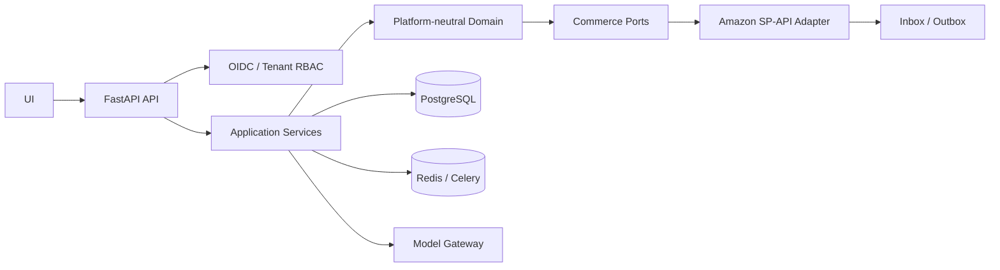

# OmniSell AI

OmniSell is a platform-neutral, multi-tenant commerce Agent backend. The first production adapter targets Amazon US SP-API, with FBA read workflows and FBM-compatible domain models.

## Implemented production foundation

- Platform-neutral domain models for tenants, products, variants, listings, orders, inventory, approvals, Agent runs and events.
- Hexagonal commerce ports and a first Amazon SP-API adapter.
- Amazon LWA authorization, encrypted refresh-token storage abstraction, token refresh, operation-scoped rate limiting and normalized errors.
- PostgreSQL/SQLAlchemy persistence, Alembic migration, tenant columns, PostgreSQL RLS policies, Inbox/Outbox and durable task records.
- Redis/Celery worker backend with PostgreSQL as task source of truth; memory queue remains for local tests.
- OIDC JWT authentication with API-key compatibility for local development.
- Explicit Agent workflow state machine, deterministic policy engine, action hashes and structured model gateway.
- Tenant-scoped task APIs and RAG filtering.
- Production and development Compose files, locked Python dependencies, CI security checks and operations runbook.

## Architecture



## Local development

Start the complete local UI, API, PostgreSQL, Redis/Celery, Mock OIDC and Mock Amazon stack without domains or TLS:

```powershell
./scripts/start_local.ps1
```

Open `http://localhost:3000` and choose a local persona. Stop with `./scripts/stop_local.ps1`; add `-ResetData` only when local PostgreSQL and Redis data should be deleted. See `docs/LOCAL_DEVELOPMENT.md` for configuration layers and cloud replacement boundaries.

For Python-only development, create a virtual environment, install `requirements.txt`, and use SQLite/memory queue settings from `.env.example`.

The default dependency set intentionally excludes the legacy in-process Chroma and local transformer stack because those optional packages currently have unresolved security advisories. Customer-service retrieval uses the deterministic FAQ fallback unless a separately reviewed vector service/client is supplied.

## Production startup

```powershell
docker compose build
docker compose run --rm migrate
docker compose up -d api worker scheduler
```

Production requires PostgreSQL, Redis, OIDC configuration, a Fernet `SECRET_ENCRYPTION_KEY`, and Amazon Draft application credentials. Keep `AUTO_CREATE_SCHEMA=false`; migrations are the only production schema mechanism.

The full local stack uses the same production-shaped backend with Mock OIDC and Mock Amazon. See `docs/LOCAL_DEVELOPMENT.md` for normal local use and `docs/MOCK_PRODUCTION_PILOT.md` for the integration contract details.

## Amazon MVP boundaries

- Marketplace: Amazon US (`ATVPDKIKX0DER`).
- Orders, Listings Item lookup and FBA inventory are implemented as read paths.
- Listing updates require structured patches and should be invoked only after policy approval.
- Direct refunds, payment reversal and autonomous order cancellation are blocked.
- FBM is represented in the domain but complete shipping/PII/RDT flows remain out of the MVP.
- Real SP-API integration tests require a Draft application and a controlled seller account.

## Operations

See `docs/RUNBOOK.md` for deployment, rollback, alerting, backup and incident procedures.

## SKU cost and profit foundation

Milestone 1 adds tenant-scoped cost CSV import and deterministic SKU profit snapshots. See `docs/product/milestone_1_profitability_foundation.md` and `docs/templates/sku_cost_profile.csv`. These APIs expose missing inputs, confidence, source/estimate status and formula version; they do not claim Amazon-verified profit unless the supplied inputs have been reconciled externally.

## Inventory health foundation

Milestone 2 adds versioned inventory policies and deterministic inventory-health snapshots with weighted sales, days of supply, stockout date, reorder point and MOQ/case-pack recommendations. See `docs/product/milestone_2_inventory_health.md`. Replenishment remains recommendation-only.

### Milestone 3: unified operational issues

OmniSell now converts persisted inventory-health and SKU-profit snapshots into tenant-scoped, deduplicated `OperationalIssue` records and structured `RecommendedAction` records. Issues expose severity, quantified impact, evidence, confidence, freshness, missing data and lifecycle state. Recommendations remain internal and recommendation-only; they do not execute Amazon or supplier writes.

See `docs/product/milestone_3_operational_issues.md` for rules, API and rollback details.

### Milestone 4: daily operations control tower

OmniSell now persists a tenant-scoped daily operations brief, ranks current profit/inventory/Listing/data-quality issues, separates financial impact by currency and exposes SKU health summaries. The Next.js console includes `/dashboard` and `/sku-health`; all recommended actions remain recommendation-only.

See `docs/product/milestone_4_daily_operations_control_tower.md` for rules, APIs and rollback details.

### Milestone 5: profit-constrained pricing

OmniSell now produces persistent price recommendations from versioned cost profiles, profit snapshots and inventory-health snapshots. Prices below break-even or discounts during critical stockout risk are blocked; below-minimum-margin and degraded-evidence cases require action-hash-bound HITL approval. The legacy competitor-only monitor remains compatible but cannot auto-write prices.

See `docs/product/milestone_5_profit_constrained_pricing.md` and `evals/pricing_guardrails.json`.

### Milestone 6: Listing quality experiments

OmniSell now persists deterministic Listing quality snapshots and approval-bound optimization experiments with before/after business guardrails. The `/listing-quality` workbench covers issue review, exact-change approval, manual execution evidence, conversion/return evaluation and keep/rollback decisions. Conversion degradation or return-rate increase creates a rollback recommendation and critical operational issue. The workflow intentionally does not call Amazon Listing update APIs in this milestone.

See `docs/product/milestone_6_listing_quality_experiments.md` and `evals/listing_experiment_guardrails.json`.

## Bounded advisor runtime

Production analysis uses four tenant-scoped, evidence-validated bounded advisors through the persistent workflow engine; Legacy AutoGen GroupChat is not a production runtime. See `docs/AGENT_RUNTIME.md` for architecture, evidence contracts, APIs, model configuration, recovery semantics, deployment requirements and external verification gaps.

For the repeatable Amazon operations demo, four architecture diagrams, eight Mock scenarios and the 10-minute interview walkthrough, see `docs/INTERVIEW_DEMO_RUNBOOK.md`.

## Operations learning loop

The test-first operations learning loop connects normalized advertising/VOC facts to deterministic findings, three operator queues, explicit touch-time evidence, structured false-positive/missed-issue feedback, manual-only execution records and bounded outcome attribution. Mock and future Amazon sources implement the same port; Mock facts remain visibly unverified and no learning workflow performs Amazon writes.

See `docs/product/operations_learning_loop.md` for the adapter contract, local drill, APIs, metrics, production gates and rollback.
