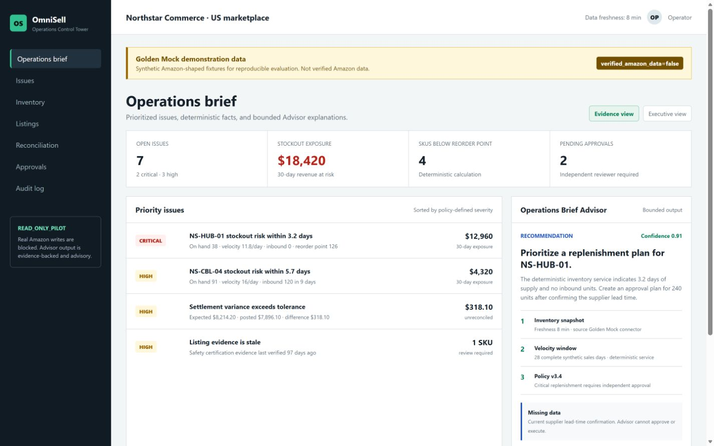
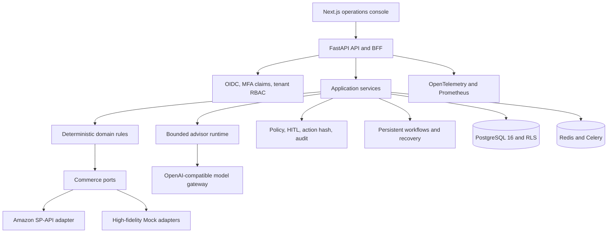

# OmniSell AI

[](https://github.com/paulrose4/omnisell-ai-agent/actions/workflows/ci.yml)


**Evidence-driven Amazon operations, with deterministic business controls and bounded AI advisors.**

OmniSell is an Amazon operations control tower, not a free-chat product. It turns commerce data into tenant-scoped facts, prioritized operational issues, approval-bound plans, and auditable execution records. LLM output is advisory: deterministic code owns money, inventory, permissions, policy, approvals, action hashes, and state transitions.

面向 Amazon 运营团队的安全型 AI 控制塔：模型负责解释证据和生成有界建议，确定性代码负责业务事实、权限、审批与执行边界。

> **Current release posture:** interview-grade engineering candidate and read-only pilot foundation. Real Amazon writes remain disabled. Mock, imported, estimated, and externally unverified data are always identified as such.

## Interview in 90 seconds

[](docs/interview/START_HERE.md)

- **Business problem:** turn scattered inventory, profitability, Listing, customer-service, and reconciliation signals into prioritized operational work.
- **Engineering decision:** deterministic code owns money, inventory, tenant scope, policy, approval, action hashes, idempotency, and final state; four bounded AI advisors explain evidence and draft reviewable recommendations.
- **Proof:** 770+ automated tests, PostgreSQL RLS with a non-owner role, four-persona Playwright E2E, migration fingerprints, agent evals, SBOM, Trivy, and Gitleaks gates.
- **Boundary:** the screenshot and golden workflow use labeled synthetic data. Real Amazon writes are blocked, and current real-provider quality remains an explicit external release gate.

Start with the [interview guide](docs/interview/START_HERE.md), then open the [one-page overview](docs/interview/ONE_PAGE_PROJECT_OVERVIEW.md), [approval-integrity incident](docs/interview/INCIDENT_02_APPROVAL_EXECUTION_BINDING.md), or [schema-repair incident](docs/interview/INCIDENT_01_SCHEMA_REPAIR_LATENCY.md).

## What OmniSell Does

| Capability | Current implementation |
| --- | --- |
| Profitability | Versioned cost profiles, CSV dry runs, `Decimal`-based SKU profit snapshots, missing-input and provenance reporting |
| Inventory health | Weighted demand, days of supply, stockout date, reorder point, MOQ/case-pack-aware replenishment recommendations |
| Operations control tower | Deduplicated issues, quantified impact, recommended actions, work queues, daily briefs, and SKU health views |
| Approval-safe execution | Policy decisions, risk levels, immutable approved plans, action hashes, idempotency keys, audit, and recovery semantics |
| Bounded AI advisors | Operations brief, customer case, Listing optimization, and reconciliation workflows with evidence, confidence, freshness, and strict schemas |
| Pricing and Listing | Profit-constrained pricing recommendations and approval-bound Listing experiments with before/after guardrails |
| Customer service and reconciliation | Tenant-scoped case workflows, response drafts, discrepancy investigation, and operator handoff |
| Learning loop | Advertising and voice-of-customer findings, operator feedback, manual execution evidence, and bounded outcome attribution |
| Amazon integration | LWA authorization, encrypted refresh-token storage, SP-API adapter, rate limiting, normalized errors, and read-only synchronization |
| Release governance | Versioned route catalog, OpenAPI/BFF drift checks, `full_development`, `golden_demo`, and `read_only_pilot` profiles |

The primary artifact is a **verified operational decision record**, not a chat transcript.

## Golden Workflow

The reference workflow is a stockout-risk loop that proves the model cannot silently become the system of record or execution authority.

```mermaid
flowchart LR
    A[Amazon or labeled Mock data] --> B[Sync and normalize]
    B --> C[Deterministic metrics]
    C --> D[Issue and work item]
    D --> E[Bounded advisor]
    E --> F[Policy evaluation]
    F --> G[Independent approval]
    G --> H[Immutable approved plan]
    H --> I[Idempotent manual execution]
    I --> J[Event ingestion and re-sync]
    J --> K[Deterministic verification]
    E -. evidence, confidence, missing data .-> D
    K -->|resolved| D
```



1. Sync Amazon-shaped data and detect a SKU stockout risk.
2. Calculate inventory facts with versioned deterministic formulas.
3. Ask a bounded advisor to explain cited evidence without changing business values.
4. Bind tenant, connection, marketplace, issue, action, evidence, policy version, and action hash into an approval request.
5. Require an independent approver; critical actions require two distinct approvers.
6. Rebuild execution only from the server-side approved plan and enforce idempotency.
7. Re-sync facts and close the issue only when deterministic verification passes.

## Architecture

OmniSell is a modular monolith with hexagonal boundaries around external commerce and model providers.



**Boundary rule:** adapters collect or execute, application services orchestrate, domain code calculates, workflows persist state, policy decides, and advisors explain. A model never calculates price floors, bypasses tenant scope, approves itself, or assembles arbitrary side-effect parameters.

### Release Profiles

| Profile | Purpose | Registered backend routes | External write posture |
| --- | --- | ---: | --- |
| `full_development` | Local development and extended modules | 136 | Still subject to auth, policy, approval, and adapter gates |
| `golden_demo` | Focused stockout demo and Mock Seller Central loop | 77 | Mock/internal workflow only |
| `read_only_pilot` | Production-shaped Amazon pilot | 119 | Real Amazon writes blocked |

Route counts come from the versioned FastAPI inventory, not text search. The frontend also versions 69 BFF files and 83 handlers, with generated profile manifests and drift checks.

## Tech Stack

| Layer | Technologies | Role |
| --- | --- | --- |
| Frontend | Next.js 15.5, React 19, TypeScript 5.7, Tailwind CSS 3.4, TanStack Query, NextAuth 5, Lucide | Operations console, OIDC sessions, profile-aware navigation, typed BFF routes |
| API | Python 3.12, FastAPI 0.135, Pydantic 2, Uvicorn | Tenant-scoped REST APIs, validation, dependency injection, health and admin surfaces |
| Domain and application | Python dataclasses/Pydantic, hexagonal ports, persistent workflow engine | Deterministic commerce rules, orchestration, approvals, execution contracts, recovery |
| Data | PostgreSQL 16, SQLAlchemy 2, Alembic, PostgreSQL RLS | Durable tenant data, constraints, frozen migration baseline, row-level isolation |
| Async runtime | Redis 7, Celery 5.5 | Durable work dispatch, workers, scheduler, retries, and task recovery |
| AI runtime | OpenAI Python SDK, OpenAI-compatible providers, strict JSON Schema, Pydantic contracts | Bounded structured generation, token/cost budgets, schema repair, controlled failover |
| Amazon | Login with Amazon OAuth, Selling Partner API, encrypted secrets | Read synchronization, connection lifecycle, rate-limited platform adapter |
| Security | OIDC JWT, MFA/AMR checks, tenant RBAC, Fernet encryption, policy engine, HITL | Authentication, authorization, secret protection, approval and execution integrity |
| Observability | OpenTelemetry, Prometheus, Grafana LGTM | Correlated traces, metrics, agent usage, latency, cost, and operational diagnostics |
| Quality | Pytest, pytest-xdist, branch coverage, Ruff, Pyright, Playwright | Unit, contract, SQLite/PostgreSQL integration, security, E2E, static and browser validation |
| Supply chain | Docker Compose, Caddy, GitHub Actions, pip-audit, Trivy, Gitleaks, SBOM | Reproducible local/production-shaped stacks and CI security gates |

## Safety Model

OmniSell treats AI as an untrusted advisory subsystem inside a governed business workflow.

| Deterministic code owns | Advisors may provide |
| --- | --- |
| Money and fee calculations | Evidence-bound explanations |
| Inventory calculations and thresholds | Root-cause hypotheses |
| Tenant scope and permissions | Draft operator summaries |
| Policy and risk decisions | Draft customer or Listing content |
| Approval state and approver separation | Explicit confidence and missing-data notes |
| Action hashes and immutable execution plans | Recommendations that still require validation |
| Idempotency, audit, recovery, and final state | No direct side effects |

Hard boundaries include:

- Every business query and persistent record is tenant-scoped; PostgreSQL RLS provides a database-level backstop.
- Money uses `Decimal` with ISO 4217 currency codes; timestamps are timezone-aware UTC.
- Side effects require authorization, policy evaluation, idempotency, action hash, audit, and recovery semantics.
- Refunds, payment reversals, autonomous cancellation, cross-tenant operations, and arbitrary tool execution are blocked.
- Real Amazon writes are disabled in the current `read_only_pilot` release posture.
- Mock, imported, estimated, and stale data cannot be presented as verified Amazon facts.

See the [threat model](docs/security/THREAT_MODEL.md), [bounded advisor runtime](docs/AGENT_RUNTIME.md), and [read-only pilot ADR](docs/adr/ADR-004-read-only-amazon-pilot.md).

## Quick Start

### Prerequisites

- Windows PowerShell or PowerShell 7
- Python 3.12
- Docker Desktop with the Docker engine running
- Node.js 22 only when running frontend checks outside Docker

### Bootstrap the development environment

```powershell
git clone https://github.com/paulrose4/omnisell-ai-agent.git
cd omnisell-ai-agent
./scripts/bootstrap_dev.ps1
```

The bootstrap script creates `.venv`, installs hash-locked dependencies, runs dependency and compile checks, validates the Alembic baseline, and executes focused security smoke tests.

### Start the complete local stack

```powershell
./scripts/start_local.ps1 -ReleaseProfile golden_demo
```

The first run creates the ignored `.env.local` from `.env.local.example` and starts:

| Service | URL |
| --- | --- |
| Operations console | `http://localhost:3000` |
| FastAPI | `http://localhost:8080` |
| Mock OIDC and Amazon cloud | `http://localhost:9000` |
| PostgreSQL | `localhost:55432` |

The sign-in page provides local Owner, Operator, Approver, and Viewer personas backed by real OIDC JWT, MFA-claim, membership, tenant, and RBAC checks.

```powershell
# Keep local data
./scripts/stop_local.ps1

# Remove containers and local PostgreSQL/Redis data
./scripts/stop_local.ps1 -ResetData
```

Detailed configuration and cloud replacement boundaries are in [Local Development](docs/LOCAL_DEVELOPMENT.md).

## Verification

### Backend

```powershell
./.venv/Scripts/python.exe -m pytest
./.venv/Scripts/python.exe -m ruff check .
./.venv/Scripts/python.exe -m ruff format --check .
./.venv/Scripts/python.exe -m pyright
./.venv/Scripts/python.exe -m compileall api application commerce domain infrastructure model_gateway workflows safety agents rag scripts
```

### Frontend

```powershell
cd frontend
npm ci
npm run check:bff-inventory
npm run check:api-types
npm run typecheck
npm run build
```

### Current local verification

The 2026-08-10 verification run records:

- 770+ automated tests are maintained. The latest dated run recorded 776 passed, 10 PostgreSQL-dependent tests skipped, and 0 failed on Python 3.12.10; see the [verification summary](docs/evidence/verification/verification-summary-2026-08-10.md).
- The clean bootstrap passed hash-locked installation, `pip check`, runtime/development `pip-audit`, compileall, schema fingerprint validation, migration roundtrip, and 66 focused safety tests.
- Ruff check/format and Pyright completed cleanly; dependency locks reproduced with the pinned `uv` 0.12.1 toolchain.
- Frontend BFF inventory, generated OpenAPI types, TypeScript checks, and the Next.js production build passed.
- npm registry signatures verified and both production and full dependency audits reported 0 vulnerabilities.
- SQLite Alembic `upgrade -> check -> downgrade -> upgrade -> check` passed.

### Versioned infrastructure evidence

The 2026-08-06 committed evidence additionally records:

- PostgreSQL 16 migration upgrade/downgrade roundtrip produced a stable schema fingerprint.
- Ten non-owner PostgreSQL RLS tests passed with an `omnisell_app` `NOBYPASSRLS` role.
- The Playwright golden stockout workflow passed with four independent OIDC personas.
- Critical-path coverage gates and 90% changed-line coverage policy were enabled.

The CI pipeline additionally shards backend suites, verifies migration and route inventories, audits dependencies, builds containers, generates SBOMs, scans images with Trivy, and scans history with Gitleaks.

### External verification gaps

These remain explicit and are not represented as completed:

- Real Amazon SP-API write operations have not been exercised and remain blocked.
- Real model-provider quality, latency, repair rate, and cost need a fresh controlled evaluation before a release go decision.
- A real enterprise OIDC issuer and named operator sign-off are still external gates.
- Business impact and adoption require a 2-4 week read-only operator pilot; Mock data does not prove seller outcomes.

## Project Structure

```text
omnisell-ai-agent/
|-- agents/             # Bounded advisors, prompts, contracts, evidence validation
|-- api/                # FastAPI composition, security, route catalog, release profiles
|-- application/        # Use cases, orchestration, workers, sync, execution contracts
|-- commerce/           # Platform-neutral ports plus Amazon and Mock adapters
|-- domain/             # Deterministic inventory, profit, pricing, issues, and work items
|-- infrastructure/     # SQLAlchemy models, tenant-scoped repositories, persistence
|-- model_gateway/      # Structured generation, budgets, failover, provider errors
|-- safety/             # Policy, HITL, authorization, audit, write and refund gates
|-- workflows/          # Persistent state machines and recovery semantics
|-- alembic/            # Frozen baseline migration with tenant indexes and RLS
|-- frontend/           # Next.js operations console and Playwright golden workflow
|-- evals/              # Versioned safety and advisor-quality datasets and scorers
|-- docs/               # Product specs, ADRs, evidence, runbooks, and interview package
|-- scripts/            # Bootstrap, verification, staging smoke, backup, and restore tools
`-- tests/              # Unit, contract, integration, PostgreSQL, security, and E2E suites
```

Legacy AutoGen demos are isolated under `legacy/autogen_demo/` and are not part of the production runtime.

## Documentation

- [One-page project overview](docs/interview/ONE_PAGE_PROJECT_OVERVIEW.md)
- [Interview in 90 seconds](docs/interview/START_HERE.md)
- [Interview package index](docs/interview/INTERVIEW_PACKAGE_INDEX.md)
- [Product and architecture overview](docs/product/amazon_operations_control_tower.md)
- [Bounded advisor runtime](docs/AGENT_RUNTIME.md)
- [Local development](docs/LOCAL_DEVELOPMENT.md)
- [Dependency maintenance and branch lifecycle](docs/DEPENDENCY_MAINTENANCE.md)
- [Operations runbook](docs/RUNBOOK.md)
- [Threat model](docs/security/THREAT_MODEL.md)
- [Production readiness audit](docs/PRODUCTION_READINESS_AUDIT.md)
- [External staging verification](docs/EXTERNAL_STAGING_VERIFICATION_RUNBOOK.md)
- [Operator acceptance criteria](docs/OPERATOR_PRODUCTION_ACCEPTANCE.md)
- [Architecture decisions](docs/adr/ADR-001-freeze-alembic-baseline-before-default-branch-merge.md)

## Production Boundaries

The current production-shaped deployment requires PostgreSQL, Redis, an OIDC provider, a Fernet `SECRET_ENCRYPTION_KEY`, Amazon application credentials, and an OpenAI-compatible model endpoint. Schema creation is migration-only: keep `AUTO_CREATE_SCHEMA=false` and run the dedicated Alembic migration job before API and worker rollout.

Deployment, rollback, backups, alerts, and incident procedures are documented in the [operations runbook](docs/RUNBOOK.md). No real Amazon write capability should be enabled without a separate action-specific security release, operator decision, and verified recovery path.
