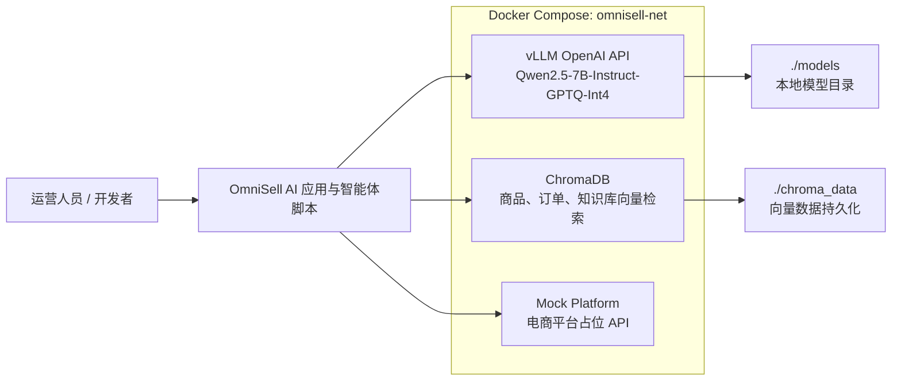

# OmniSell AI

OmniSell AI 是一个面向电商运营场景的 AI 自动化项目基础设施，集成本地大模型推理、向量数据库和电商平台模拟服务。

## 系统架构



## 目录结构

```text
omnisell-ai/
├── docker-compose.yml
├── .env.example
├── requirements.txt
├── README.md
├── models/
├── scripts/
│   ├── download_model.py
│   └── test_vllm.py
└── mock_platform/
    ├── Dockerfile
    ├── server.py
    ├── oauth_server.py
    ├── config.py
    ├── requirements.txt
    ├── data/
    │   ├── products.json
    │   ├── orders.json
    │   └── users.json
    └── routes/
        ├── __init__.py
        ├── auth_routes.py
        ├── product_routes.py
        └── order_routes.py
```

## 快速开始

1. 创建并激活 Python 虚拟环境：

```bash
python -m venv .venv
source .venv/bin/activate
```

Windows PowerShell:

```powershell
python -m venv .venv
.\.venv\Scripts\Activate.ps1
```

2. 安装依赖：

```bash
pip install -r requirements.txt
```

3. 复制环境变量文件：

```bash
cp .env.example .env
```

Windows PowerShell:

```powershell
Copy-Item .env.example .env
```

4. 下载模型：

```bash
python scripts/download_model.py
```

模型会下载到：

```text
./models/Qwen2.5-7B-Instruct-GPTQ-Int4
```

5. 启动服务：

```bash
docker compose up -d
```

6. 查看服务状态：

```bash
docker compose ps
```

7. 测试 vLLM 连接：

```bash
python scripts/test_vllm.py
```

## 服务地址

| 服务 | 地址 | 说明 |
| --- | --- | --- |
| vLLM OpenAI API | http://localhost:8000/v1 | 本地大模型 OpenAI 兼容接口 |
| vLLM Health | http://localhost:8000/health | vLLM 健康检查 |
| ChromaDB | http://localhost:8001 | 向量数据库 |
| Mock Platform | http://localhost:8002 | 电商平台占位 API |
| Mock Platform Docs | http://localhost:8002/docs | Mock API Swagger 文档 |

## 技术栈

| 类别 | 技术 | 用途 |
| --- | --- | --- |
| 大模型推理 | vLLM | 提供高性能 OpenAI 兼容推理服务 |
| 模型 | Qwen2.5-7B-Instruct-GPTQ-Int4 | 中文电商智能体基础模型 |
| 向量数据库 | ChromaDB | 存储商品、订单、知识库等向量数据 |
| API 框架 | FastAPI | 构建 Mock Platform 和后续业务 API |
| ASGI 服务器 | Uvicorn | 运行 FastAPI 服务 |
| LLM SDK | OpenAI Python SDK | 调用 vLLM OpenAI 兼容接口 |
| 模型下载 | huggingface_hub | 从 Hugging Face 下载模型快照 |
| 容器编排 | Docker Compose | 本地启动 vLLM、ChromaDB、Mock Platform |
| 自动化框架 | pyautogen | 构建多智能体协作流程 |
| 日志 | Loguru | 结构化运行日志 |
| 重试 | Tenacity | API 调用和任务执行重试 |

## 常用命令

```bash
docker compose logs -f vllm-server
docker compose logs -f chromadb
docker compose logs -f mock-platform
docker compose down
```

## 注意事项

- vLLM 服务需要可用的 NVIDIA GPU、NVIDIA Container Toolkit 和 Docker GPU 支持。
- 首次启动 vLLM 前，请先运行 `python scripts/download_model.py` 下载模型。
- 如果 Hugging Face 下载速度较慢，可以提前配置镜像源或登录令牌。
- ChromaDB 数据会持久化到 `./chroma_data`。
