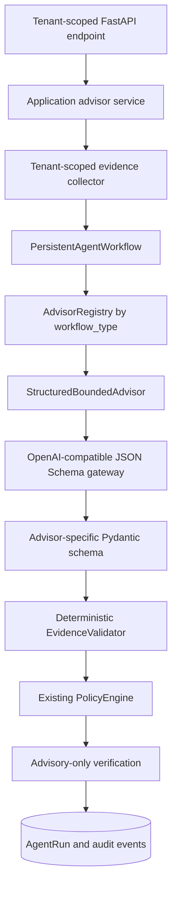

# Bounded Advisor Runtime

## Purpose

OmniSell is an Amazon operations control tower. It does not use free-chat agents for production state changes. `PersistentAgentWorkflow` owns durable state transitions; deterministic application/domain services own commerce facts and calculations; bounded advisors only interpret persisted evidence and draft internal recommendations.

## Architecture



Production does not initialize Legacy AutoGen `GroupChatManager`, `UserProxyAgent`, or `app.state.team`. The optional legacy demo fails explicitly when a compatible legacy runtime is absent and has no product, order, return, or price write tools.

## Advisors and boundaries

| Workflow type | Advisor | Persisted inputs | Allowed output | Never allowed |
|---|---|---|---|---|
| `operations_brief_analysis` | `OperationsBriefAnalyst` | Daily brief, priority issues/actions, SKU health and source manifest | Explanations, issue grouping, hypotheses, missing data, checklist, internal task drafts | Reprioritization, financial/inventory calculation, Amazon writes |
| `customer_case_analysis` | `CustomerCaseAdvisor` | Customer case, buyer message, order evidence, timeline, playbook, communication policy, RAG manifest | Intent/entity extraction, sentiment/urgency suggestion, compliant reply draft, escalation and VOC tags | Refund, compensation, cancellation, message send, invented order status |
| `listing_optimization_analysis` | `ListingOptimizationAdvisor` | Listing quality snapshot, persisted content/facts, marketplace constraints, search evidence, experiment history | Evidence-backed structured copy drafts and experiment hypothesis | Unsupported product claims or Listing publication |
| `reconciliation_investigation` | `ReconciliationInvestigator` | Reconciliation run/differences, connection metadata, sync tasks, Inbox failures and audit summaries | Difference clusters, hypotheses, read-only checks and investigation task drafts | Choosing Amazon/internal truth or overwriting either system |

All proposed actions have `automation_eligible=false`. Refunds, payment reversals, autonomous cancellation, approval bypass, cross-tenant actions, and arbitrary Amazon writes are permanently rejected by deterministic validation and policy.

## Evidence contract

Each `EvidenceReference` records:

- stable `evidence_id`, type and resource identity;
- source classification (`amazon_api`, `advertising_api`, `csv_import`, `manual`, `system_estimate`, `mock`, or `internal_record`);
- observed/collected timezone-aware UTC timestamps and freshness;
- Decimal confidence, canonical content digest and minimized JSON metadata;
- whether the record is verified Amazon data.

Only platform API evidence can be marked verified Amazon data. Mock, manual, CSV, estimated and internal records cannot make that claim. Advisor citations must exist in the exact input bundle. Referenced resource IDs must exist. High confidence requires fresh structured evidence, blocking missing data caps confidence at `0.65`, and deterministic values such as persisted scores or money must match exactly.

## Workflow and recovery

Advisory runs transition through:

`received -> validated -> evidence_collected -> analyzed -> output_validated -> policy_evaluated -> verifying -> succeeded|degraded`

Failures transition to `failed`, persist an error category, emit a low-sensitivity audit event and remain retryable when the failure class permits it. `POST /api/agent-runs/{run_id}/resume` creates a new retry run with `retry:<run_id>:<attempt>` rather than mutating terminal history. Tenant/workflow/idempotency uniqueness prevents duplicate model execution.

Approval resume is fail-closed. Before any deterministic executor runs, the workflow recomputes and compares the canonical action hash, approved plan snapshot, evidence snapshot, expected changes, tenant/run/action index/resource identity, independent approver and approval expiry. A mismatch persists `failed`, `ApprovalIntegrityError` and `retryable=false`; it never falls through to execution.

HITL is not an override for permanently prohibited actions. Refund, payment-reversal and Agent cancellation intents are rejected before an in-memory or SQL approval request is created, including structured intents nested under `arguments`, `execution_plan` or `plan`. If a prohibited legacy record already exists in `pending`, an approval attempt atomically persists `rejected`, identifies policy as the decision maker, emits a blocked audit event and raises `ApprovalRejectedError`. No approver count can convert it to `approved`.

The workflow never invokes an Amazon executor for these four roles. Verification persists `amazon_write_performed=false` and `advisory_only=true`.

## API

All submission endpoints require authentication, tenant context, read scope and an `Idempotency-Key` header:

- `POST /api/agent-runs/operations-brief-analysis`
- `POST /api/agent-runs/customer-case-analysis`
- `POST /api/agent-runs/listing-optimization-analysis`
- `POST /api/agent-runs/reconciliation-investigation`
- `GET /api/agent-runs`
- `GET /api/agent-runs/{run_id}`
- `POST /api/agent-runs/{run_id}/resume`

Analysis submission creates an AgentRun and a tenant-scoped durable task, then returns HTTP `202` without waiting for evidence collection or the model. The response includes `run_id`, `task_id`, run status and task status. Cross-tenant IDs return `404` without existence disclosure.

## Model configuration

The gateway performs one low-temperature JSON Schema generation and allows at most one schema repair. It never falls back to free text. It classifies failures as `ModelUnavailable`, `ModelTimeout`, `ModelBudgetExceeded`, `ModelSchemaError`, or `ModelSafetyRejected`. Provider usage is also a data contract: missing, invalid, negative or inconsistent prompt/completion/total token counts fail closed rather than silently becoming zero.

```env
MODEL_BASE_URL=https://api.hxprice.com/v1
MODEL_NAME=gpt-5.6-terra
MODEL_API_KEY=from-secret-manager
MODEL_MAX_TOKENS_PER_TASK=36000
MODEL_TIMEOUT_SECONDS=240
MODEL_INPUT_COST_PER_MILLION=2.5
MODEL_OUTPUT_COST_PER_MILLION=15
MODEL_PRICING_VERSION=approved-provider-pricing-2026-08
MODEL_PRICING_EFFECTIVE_AT=2026-08-01T00:00:00Z
MODEL_BILL_ON_UNKNOWN_FAILURE=true
AGENT_TENANT_QUOTA_PER_MINUTE=10
AGENT_TENANT_QUOTA_PER_DAY=200
```

The optional failover provider is disabled by default. Enable it only after approving its model, latency, cost and data-processing terms:

```env
MODEL_FALLBACK_ENABLED=true
MODEL_FALLBACK_BASE_URL=https://api.wenrugouai.com/v1
MODEL_FALLBACK_MODEL_NAME=approved-fallback-model
MODEL_FALLBACK_API_KEY=from-secret-manager
MODEL_FALLBACK_PROVIDER=wenrugouai_openai_compatible
MODEL_FALLBACK_TIMEOUT_SECONDS=240
MODEL_FALLBACK_INPUT_COST_PER_MILLION=1.00
MODEL_FALLBACK_OUTPUT_COST_PER_MILLION=2.00
MODEL_FALLBACK_PRICING_VERSION=approved-fallback-pricing-2026-08
MODEL_FALLBACK_PRICING_EFFECTIVE_AT=2026-08-01T00:00:00Z
MODEL_FALLBACK_BILL_ON_UNKNOWN_FAILURE=true
```

Failover is attempted at most once and only for timeout, connection, rate-limit or retryable provider 5xx failures. Schema, safety, context, usage and budget failures remain failed/degraded and never switch providers. Preflight reserves the sum of primary and fallback worst-case attempts; enabling fallback cannot lower the Token or cost reservation. Successful fallback usage records both providers, the primary failure category and the backup model; unknown primary billing remains a conservative unattributed upper bound rather than being recorded as zero.

Configure non-zero cost rates and versioned effective timestamps for production estimates. The global token budget must reserve the initial response plus one Schema repair; startup fails if it is incompatible with any Advisor profile. `ModelUsage` persists provider/model, Prompt and Schema versions/hashes, reserved/reported/unattributed costs, token counts, first-pass Schema success, failure categories, initial/repair latency, provider-call count, retry/failover metadata and provider request ID.

`VLLM_BASE_URL`, `VLLM_MODEL_NAME`, and `VLLM_API_KEY` are deprecated compatibility aliases scheduled for removal in `2.0.0`. A legacy-only configuration emits a warning without exposing secrets; conflicting new and legacy values fail startup.

## Local development and tests

Install dependencies with `requirements.txt`; `pyautogen` is intentionally absent from production dependencies. Tests use `FakeModelGateway` and do not require an external model.

```powershell
python -m pytest tests/test_agent_contracts.py tests/test_agent_runtime.py tests/test_agent_evals.py -q
python -m pytest -q
python -m compileall -q agents application workflows api model_gateway infrastructure domain safety
python -m alembic upgrade head
```

Real-model smoke tests must be explicit opt-in and must use sanitized non-production evidence.

For the complete local company workflow, run `./scripts/start_local.ps1`. The script starts PostgreSQL, Redis, migration, API, Celery worker/scheduler, Mock OIDC/SP-API and the frontend. The UI is available at `http://localhost:3000`; API health is at `http://localhost:8080/api/admin/health`. The authenticated frontend smoke now calls the protected Listing BFF, not only the dashboard shell.

## Observability and data handling

Low-cardinality spans include `agent.workflow`, `agent.evidence.collect`, `agent.model.generate`, `agent.output.validate`, `agent.evidence.validate`, `agent.policy.evaluate`, `agent.approval.wait`, `agent.executor.execute`, and `agent.verify`. Audit events cover run start, evidence collection, model generation, policy evaluation, approval, execution, verification and failures. Tracing excludes tenant/operator/run/correlation/resource identifiers, action hashes, idempotency keys and raw SP-API paths. SQL and JSONL audit sinks share one recursive sanitizer for tokens, credentials, buyer/customer messages, replies, prompts, evidence, orders and addresses.

## Production requirements

- PostgreSQL migrations through Alembic; the application role remains protected by tenant RLS.
- Redis/Celery for durable background execution where enabled.
- OIDC tenant identity and scopes.
- `AUTO_CREATE_SCHEMA=false` in production.
- Explicit model endpoint, model, timeout, token budget and cost rates.
- `AMAZON_WRITES_ENABLED=false` and `AMAZON_PILOT_READ_ONLY=true`; production startup rejects any other values for this release, so environment changes alone cannot enable Amazon writes.
- Human approvals remain independent from requesters for deterministic write workflows.
- Mock customer-service, scenario and Seller Central execution routes are not mounted in production. The frontend also returns 404 for Mock pages and BFF routes when the drill is disabled.
- Frontend OIDC middleware requires a present, unexpired access token. Incomplete or expired page sessions redirect to sign-in and protected BFF calls receive structured HTTP 401 instead of server errors.

## External verification gaps

The default CI does not call a real LLM or Amazon. Sanitized hxprice `gpt-5.6-terra` compatibility passed on 2026-07-18, but the following still require controlled external evidence and operator sign-off:

- real token/cost accounting against the selected model provider;
- sustained hxprice availability and latency under the approved staging workload;
- Amazon SP-API evidence freshness and provenance in a controlled seller account;
- production OTLP export and alert routing;
- named Operations, Customer Service, Listing, Reconciliation and Platform owner sign-off.


## Production hardening baseline

### Deterministic budget profiles

AGENT_BUDGET_PROFILES configures a separate bounded profile for each workflow type. Profiles may change only through reviewed deployment configuration; API clients cannot submit arbitrary budget fields. Each profile defines maximum prompt and completion tokens, maximum estimated model cost, maximum evidence count, maximum serialized size of one evidence reference, maximum total serialized evidence, maximum complete request bytes, and model timeout. Runtime preflight deterministically selects evidence before the provider call, reserves one repair call in worst-case cost, and persists selected/omitted evidence IDs in `evidence_preparation`.

Evidence count and serialized evidence size are checked before any provider request. Token and cost usage are checked again after generation and after the optional single schema repair. Production configuration rejects zero input or output cost rates.

The provider receives `max_completion_tokens` from the selected profile. Prompt and completion limits are enforced independently after every call, and an outer deadline remains classified as `ModelTimeout` so retry and operator handling stay explainable.

### Tenant call quotas

`AGENT_TENANT_QUOTA_PER_MINUTE` and `AGENT_TENANT_QUOTA_PER_DAY` cap new model-backed runs across all four Advisors for one tenant. An idempotent replay does not consume quota; a genuinely new run or retry does. Production uses one Redis Lua transaction to check and increment both windows atomically. Tenant IDs are hashed in Redis keys.

Quota exhaustion creates a tenant-scoped failed AgentRun with `AgentQuotaExceeded`, emits an `agent_quota_exceeded` audit event, skips evidence/model work and returns HTTP `429` with `Retry-After`. A Redis quota-backend failure is fail-closed and returns HTTP `503`; it never permits an unmetered model call.

Call quotas bound the worst-case spend together with each Advisor's per-run cost cap. A separate daily actual-token/actual-cost accounting policy remains an operator decision before production enablement.

### Concurrency and recovery

Tenant/workflow/idempotency ownership is claimed by the database. Concurrent submissions with the same key receive the same run ID, but only the transaction that created the row may collect evidence or invoke the model. Concurrent resume requests reuse the active retry attempt; a new attempt number is allocated only after the previous retry run has itself failed.

Production dispatch reuses the existing PostgreSQL DurableTask repository and Celery `text` queue. A Redis execution lock prevents concurrent delivery of the same AgentRun. Because Celery uses late acknowledgement, a worker crash causes redelivery; after the lock lease expires, a non-terminal AgentRun is reset to `received` with recovery history and safely re-executed. Advisor runs remain read-only, so crash recovery cannot duplicate an Amazon side effect. Dispatch task ID and status are persisted in AgentRun state for operator tracing.

Local OIDC/Celery smoke on 2026-07-18 returned HTTP `202` in 55-70 ms while the run continued in the Worker. Two concurrent resume requests returned the same retry run in 64 ms. The external provider subsequently returned Cloudflare 504 responses; those runs were correctly persisted as retryable `ModelUnavailable` failures.

The local stack was rebuilt and revalidated on 2026-07-19: migration revision 0017, four ready Advisors, one responsive Celery worker, protected Listing BFF access, synchronized Mock Listing snapshot creation, encrypted Amazon refresh token storage and `blocked_read_only_pilot` for the write probe. Browser checks covered desktop and a 375px mobile viewport without document-level horizontal overflow.

A same-day diagnostic found that the smoke tool had drifted from runtime by applying one fixed 6,000 prompt / 3,000 completion budget to every Advisor. It now loads the same typed per-workflow profile source as runtime, preserves explicit fault-injection overrides, records applied budgets in the redacted manifest and includes safe numeric diagnostics for `ModelBudgetExceeded` without recording Prompt or response content.

The final 2026-07-19 single-manifest real-model run passed all four normal cases after one bounded repair each: Operations v4 11,511 tokens / `$0.0879650` / 89.3 s; Customer Case v3 7,757 / `$0.0465425` / 41.3 s; Listing v3 6,115 / `$0.0343375` / 35.8 s; Reconciliation v5 10,130 / `$0.0716750` / 69.4 s. Every case had a provider request ID and stayed inside its prompt, completion, cost and timeout profile.

Listing v3 explicitly caps confidence at `0.65` when blocking product facts are missing. Reconciliation v5 forbids invented target quantities and other numeric targets in read-only action arguments. Current prompt-injection, nonexistent-evidence and forbidden-action smokes also passed with no forbidden proposed action and no side effect.

### Metrics and recommended alerts

The admin JSON and Prometheus metrics expose Agent run counts by terminal status and workflow, P50/P95 latency, total tokens, estimated cost, schema repair count, evidence-validation failures and retry count. Recommended initial alerts are:

- failed or degraded ratio above 10% for 15 minutes;
- P95 latency above the configured workflow timeout warning threshold;
- schema repair ratio above 5%;
- any sustained evidence-validation failure increase;
- retry ratio above 10%;
- unexpected tenant volume or cost growth above the approved daily budget.

## Operator acceptance decisions

The following decisions require named business owners before production enablement:

| Area | Required owner decision |
|---|---|
| Operations brief | Who may submit analyses; maximum acceptable evidence age; when degraded output must block operator action |
| Customer cases | Which reply drafts always require approval; escalation SLA; prohibition on refunds, compensation and cancellation |
| Listing optimization | Required product-fact evidence; experiment approver; publication remains outside the Advisor runtime |
| Reconciliation | Which team owns each difference class; when investigation must stop for missing source evidence |
| Platform | Who may resume failed runs; daily tenant token/cost quota; audit retention; model outage procedure |

A launch sign-off must record the owner, decision, date, environment and rollback contact. Customer replies should begin in all-drafts-require-approval mode. Refunds, payment reversals and autonomous cancellation remain permanently blocked regardless of sign-off.

## Staging verification gates

Before production rollout, run all of the following in a controlled staging environment:

1. Clean virtual-environment install, pip check and full pytest.
2. PostgreSQL upgrade head -> downgrade base -> upgrade head using the migration owner.
3. Set POSTGRES_RLS_URL and run pytest -q tests/test_postgres_rls.py using generated non-owner roles.
4. Run a real provider structured-output smoke with sanitized evidence and explicit operator opt-in.
5. Run Amazon sandbox read-only collection; verify timestamps, freshness, resource identity and verified_amazon_data semantics.
6. Review logs, traces and audit records for tokens, addresses, buyer messages and full order payloads.

Real provider and Amazon checks must never be silently replaced with mock success.

Executable external checks are provided by `scripts/run_real_model_staging_smoke.py` and `scripts/run_amazon_readonly_smoke.py`. They require explicit opt-in flags, refuse production environments, use sanitized or bounded staging inputs, and write redacted manifests. Follow `docs/EXTERNAL_STAGING_VERIFICATION_RUNBOOK.md` for operator comparison, failure injection and sign-off.
