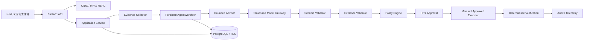
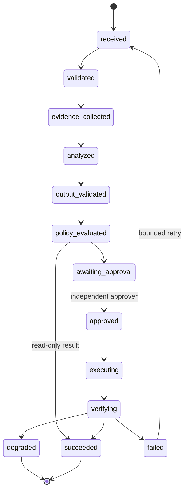
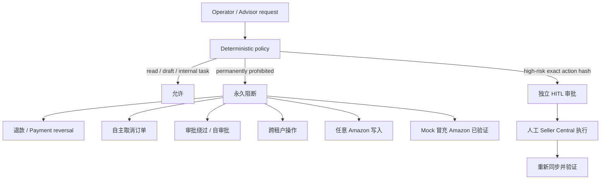
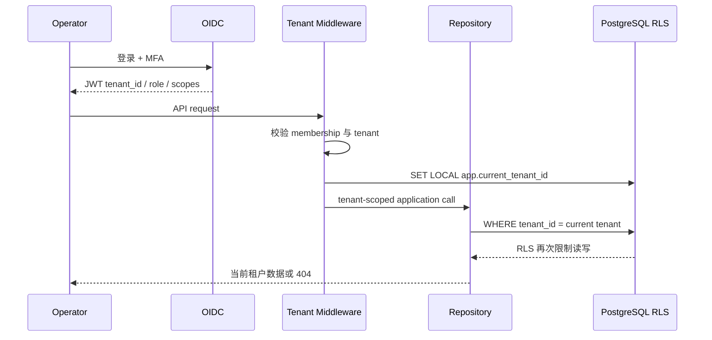

# OmniSell 运营控制塔演示与架构说明

## 产品定位

OmniSell 不是聊天机器人。它把 Amazon 运营中的异常发现、证据核查、负责人分配、SLA、独立审批、人工执行、结果验证和审计放入一个可恢复流程。

演示目标不是声称已经接入真实 Seller 数据，而是证明：

- 确定性代码负责金额、利润、库存、优先级、权限和状态；
- Advisor 只生成有 Schema、有证据引用的结构化建议；
- Mock、人工和导入数据不会显示为 Amazon 已验证；
- 高风险动作需要独立审批，永久禁止动作不能通过审批放行；
- 模型失败时不生成假结果，确定性运营能力仍可继续使用；
- 每个任务都有负责人、SLA、执行凭证、验证结果和下一步。

## 运行时架构

关键说明：LLM 不拥有业务事实，不直接操作 Amazon，不计算利润或补货量，也不能改变确定性优先级。

## 运营任务状态机

业务 Work Item 使用同一业务闭环：待认领、已分配、处理中、等待审批、验证中、已完成或已取消。源异常解决后，关联 Work Item 必须同步关闭。

## 安全边界

本地演示和 Read-only Pilot 必须保持 `AMAZON_WRITES_ENABLED=false` 与 `AMAZON_PILOT_READ_ONLY=true`。

## 租户隔离

Repository 条件和 PostgreSQL RLS 是两层防线。跨租户资源查询不暴露资源是否存在。

## 固定 Mock 场景

| 场景 | 运营判断 | 预期系统结果 |
| --- | --- | --- |
| 健康 SKU | 无需动作 | 保持健康，不制造任务 |
| 紧急缺货 | 覆盖天数低于总提前期 | 创建紧急补货复核任务和 1 小时 SLA |
| 亏损 SKU | 贡献利润为负 | 阻止盲目补货，复核价格、成本和广告 |
| 冗余库存 | 覆盖过高 | 创建库存处置任务，不自动降价 |
| 高 ACoS | ACoS 超过盈亏平衡线 | 创建广告复核任务并显示 ACoS/TACOS/CTR/CVR/CPC |
| VOC 损坏反馈 | 样本达到阈值 | 聚合退货、评论、客服标签并创建产品改进任务 |
| Listing 质量差 | 内容字段缺失 | 创建结构化改稿和受控实验，不直接发布 |
| Buy Box / Stranded | Amazon 状态异常 | 创建只读核查任务，保留来源和观测时间 |

场景控制台的“重置演示租户”会清理当前租户派生数据并恢复确定性配置。重置后必须重新同步，不能把历史运行与当前演示混在一起。

## 演示前准备

1. 启动 Docker Desktop。
2. 运行 `./scripts/start_local.ps1 -NoBuild`；镜像变化后去掉 `-NoBuild`。
3. 打开 `http://localhost:3000`，使用 Owner 登录。
4. 在“场景控制台”点击“重置演示租户”。
5. 完成 Mock Amazon 只读同步并生成今日简报。
6. 预先打开 Owner、Operator 和 Approver 三个独立浏览器会话。
7. 确认页面顶部显示“非生产”，侧栏显示“Amazon 只读”。

## 10 分钟演示脚本

### 0:00-1:00 产品定位

打开“经营总览”。说明运营不再在 Seller Central、广告后台、客服系统和表格之间人工寻找异常，首页直接给出紧急、逾期、待审批、数据过期和验证失败队列。

### 1:00-5:00 缺货闭环

1. 从“今日运营队列”打开缺货任务。
2. 展示业务影响、库存证据、来源、新鲜度、负责人和 SLA。
3. Operator 认领并开始处理。
4. 展示确定性覆盖天数、总提前期和补货建议，强调这些值不是模型计算。
5. 提交 exact-action-hash 绑定的 HITL 请求。
6. 切换 Approver，说明发起人不能自审批。
7. 在 Mock Seller Central 记录人工执行凭证。
8. 重新同步并展示验证完成、异常与 Work Item 同时关闭。

### 5:00-6:30 广告与 VOC

1. 打开“广告与 Amazon 异常”，展示 ACoS、TACOS、CTR、CVR、CPC 和预算消耗。
2. 展示 Search Term 花费、销售额和点击无订单证据。
3. 切换 VOC，先展示样本不足不下结论，再展示样本达到阈值后生成产品改进任务。

### 6:30-8:00 Listing 实验

1. 展示修改前内容和结构化质量问题。
2. 展示 12 个控制变量的完整度。
3. 演示稳定控制变量下的 `directional_improvement`。
4. 再展示广告、价格、库存或 Buy Box 漂移后的 `confounded`。
5. 强调系统只记录方向性改善，不宣称统计因果；发布和回滚均为审批后的人工操作。

### 8:00-9:00 安全边界

依次触发退款、取消、审批绕过、自审批或任意 Amazon 写入请求。展示 Policy 在代码层阻断，HITL 不能覆盖永久禁止规则。

### 9:00-10:00 工程实现

打开“Agent 监控”，展示：

- 结构化模型建议与确定性运行分区；
- Schema、证据覆盖、Token、成本、重试和失败阶段；
- 模型失败时的安全降级，不产生自由文本回退；
- 四张架构图、PostgreSQL RLS、action hash 和测试结果。

## 运营验收标准

一次演示只有同时满足下列条件才通过：

- 首页可在 30 秒内定位当天最紧急的五项工作；
- 任务详情不依赖口头解释即可看懂影响、来源、负责人、SLA 和下一步；
- 任一事实都能区分 Amazon API、Mock、人工、CSV、系统估算和过期数据；
- 样本或控制变量不足时系统显示降级、混杂或证据不足；
- 高风险动作由不同用户审批，执行凭证和验证结果可追溯；
- 模型不可用时业务队列、确定性计算、Policy、HITL 和验证仍可工作；
- 全程没有真实 Amazon 写入，也没有 Mock 数据被标记为 Amazon 已验证。

## 必须主动说明的限制

- 当前本地演示使用 Mock Amazon 或导入数据，不代表真实 Seller 数据质量。
- Amazon 写入关闭，Seller Central 操作仅记录人工执行凭证。
- Listing 实验提供方向性判断，不提供统计因果证明。
- 真实 Advertising API、VOC、Account Health 和 SP-API 分页/限流仍需 Read-only Staging 验证。
- 模型供应商的持续可用性、账单对账和中文运营质量仍是上线门禁。
- 对外表述应为“安全型只读运营控制塔和 Mock SOP 已验收”，不能表述为“已生产就绪”。

## 面试重点代码

- `workflows/engine.py`：持久化工作流、失败与恢复。
- `agents/validators/evidence.py`：证据引用和来源真实性。
- `application/agent_services.py`：租户范围内的 Run 查询与重试。
- `safety/policy_engine.py`：永久阻断和动作哈希。
- `api/middleware.py`、`api/security.py`：OIDC、tenant context 和权限。
- `infrastructure/repositories/operations.py`：异常、建议和 Work Item 同步。
- `tests/test_postgres_rls.py`：非 owner 角色下的跨租户防护。
