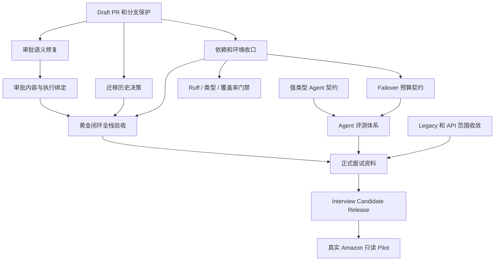
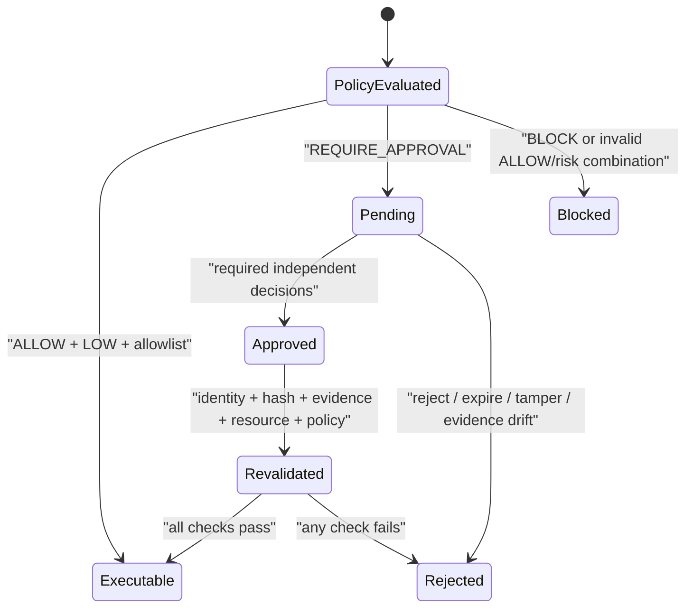

# OmniSell 项目优化与面试交付方案

> 文档版本：v1.7
> 审计日期：2026-08-05  
> 审计对象：`codex/agent-production-hardening`；远端基线 `d533bfa`，并包含当前本地待提交优化批次
> 文档性质：实施蓝图与验收规范，不等同于完成声明

## 1. 文档目的

本文档面向 OmniSell 当前的 `codex/agent-production-hardening` 分支，目标不是继续扩大产品范围，而是把现有技术能力整理成一个可以审查、可以复现、可以量化、可以在面试中清晰讲述的高级智能体工程项目。

本文档覆盖以下交付目标：

- 修复影响安全语义、迁移可信度、依赖安全和环境复现的 P0 问题；
- 补齐模型 Failover、Agent 契约、评测、延迟和工程门禁；
- 建立一条可由浏览器和真实基础设施完整验收的缺货黄金闭环；
- 收敛面试演示范围，同时保留现有扩展业务能力；
- 形成评测报告、威胁模型、ADR、失败复盘和个人贡献说明；
- 明确 Mock、真实模型、真实 Amazon 和生产写入之间不可混淆的证据边界。

本文档同时承担当前状态审计和剩余实施蓝图两项职责。每项优化必须遵守测试先行、租户隔离、确定性业务边界、审批完整性和外部证据真实性要求。任何“完成”状态都必须同时具备代码、自动化验证、可审查提交和证据产物；本地测试、Mock、真实基础设施和真实业务证据必须分级陈述。

## 2. 当前基线

### 2.1 已提交基线与当前工作树

已提交、可从远端复现的基线：

- 当前分支：`codex/agent-production-hardening`。
- 当前提交：`d533bfa`，与 `origin/codex/agent-production-hardening` 一致。
- 相对 `origin/main`：领先 17 个可审查提交，其中前 10 个构成平台、业务域、Agent、前端、UAT 和发布基线，后 7 个完成审批完整性、Agent 契约与评测、工具链、核心服务、平台、演示导航和面试资料收口。
- 当前分支有 524 个跟踪文件；相对默认分支有 519 个文件变化、83,961 行新增和 4,142 行删除。该规模说明必须通过提交分组和面试导航控制审查范围，不能要求面试官无差别阅读全仓。
- `origin/main` 仍停留在 `822d6e0`，因此 GitHub 默认入口尚未展示完整系统。
- 历史上的 450 个未跟踪文件阻塞已经关闭；但本次审计时工作树仍有 41 个已跟踪文件发生变化和 22 个未跟踪路径，尚未形成新的远端审查证据。必须把它们作为新的可审查批次提交，不能把本地验证结果提前算入远端交付。

远端 `d533bfa` 已提交实现状态如下：

- 审批语义已分离 `policy_decision` 与 `risk_level`；内存/SQL HITL、Workflow 恢复和数据库约束已统一。任何 `REQUIRE_APPROVAL` 都保持真实人工审批，`ALLOW + non-low` fail closed。
- 审批内容与实际执行已通过 typed manual execution contract 严格绑定。客户端不能提交 action type 或 quantity，执行端只接受 approval ID、Idempotency-Key、备注和执行证据，并在 side effect 前重验 tenant、connection、marketplace、plan、hash、policy、状态与过期时间。
- 迁移已采用显式冻结的 `0023_frozen_baseline.py`，并提供 migration ADR、SQLite schema fingerprint 与静态检查。独立 PostgreSQL 16 审计库上的空库 `upgrade head`、`alembic check` 和 8 项 RLS/non-owner 测试已经通过；PostgreSQL downgrade/upgrade 往返、catalog fingerprint、固定 `omnisell_app` 运行角色、执行并发和旧环境升级仍是门禁。
- `cryptography` 已升级为 `50.0.0`，runtime/dev lock 可重复，`pip check` 和两套 `pip-audit` 通过。`bootstrap_dev.ps1` 已在包含中文的 Windows 路径两次完成 clean bootstrap，并生成版本化脱敏证据。
- Failover 已增加类型化最坏预算契约，Agent 主要输出已改为强类型模型和 discriminated union；版本化数据集、fixed-fixture 报告与 Schema 大小证据已存在，真实 provider 质量仍为 `not_verified`。
- Legacy AutoGen 已移动到 `legacy/autogen_demo/`，通用配置迁移到 `MODEL_*` 并保留一版 `VLLM_*` 兼容别名；前端已增加初版面试导航配置。
- API/ASGI 级缺货黄金闭环已覆盖重置、同步、认领、双人审批、Mock 执行、事件消费、重新同步、Issue resolved、Execution verified 和 Work Item completed；Compose 首次候选启动已执行但被辅助 `mock-cloud` 依赖解析冲突阻断，OIDC 身份切换和 Playwright 浏览器验收尚未完成。
- 工具链已完成 `pyproject.toml`、Ruff、Pyright、branch coverage、关键模块门禁和独立 CI coverage job；该远端基线已有可复现的本地质量证据。
- 正式面试包已新增一页项目说明、Threat Model、三篇核心 ADR、两个失败复盘、API/演示范围和贡献矩阵，并有自动文档门禁。
- 当前分支已经是可从远端复现的审查证据，但尚未等同于默认分支候选发布。最终状态仍必须以 Draft PR、Required Checks、默认分支合并、clean clone 复验和外部验证产物为准。

当前本地待提交批次进一步完成了以下实现：

- 正式定义 `full_development`、`golden_demo`、`read_only_pilot` 三种 Release Profile；旧 `full`、`interview` 仅作为兼容别名并计划在 `2.0.0` 删除。生产环境强制使用 `read_only_pilot`。
- 后端路由改为由统一 catalog 注册，生成版本化 route inventory。当前稳定口径为 136 个 method/path 条目，其中 `golden_demo` 注册 77 条，`read_only_pilot` 注册 119 条；前端 69 个 BFF 文件导出 83 个 HTTP handler，81 个代理全部映射到已注册后端路由，2 个明确标记为 NextAuth。
- `EvidenceReference.metadata` 已从开放 `Any` 收紧为递归 `JsonValue`，并增加深度、集合、节点、字符串、key 和有限数上限；Legacy payload 在 `deepcopy` 前执行同类资源预算校验，`NaN/Infinity` 已在复制和持久化前 fail closed。
- 历史 Agent payload 已增加只读兼容扫描器：必须显式逐租户授权，PostgreSQL 使用只读事务和 `app.current_tenant_id`，报告只输出计数、哈希 tenant ref、稳定原因码和 record ID。版本化 deterministic fixture 已证明分类与脱敏契约，但当前工作区没有可扫描的持久数据库，真实历史数据扫描仍是 Database Owner 外部门禁。
- Agent metadata 已通过统一 Audit sanitizer 完成递归敏感字段处理；JSONL 与 SQL Audit 对 `api_key`、`Authorization`、buyer message 和列表内嵌 secret 使用相同的 redaction/hash 语义。Advisor workflow 继续禁止把原始 request 和 `analysis_result` 写入阶段审计。
- `scripts/test_vllm.py` 已删除并由 `scripts/test_model_gateway.py` 取代；生产调用方统一使用 Settings 和 `MODEL_*`，`VLLM_*` 只允许出现在兼容层、测试和迁移文档，明确删除版本为 `2.0.0`。
- Pyright 和关键覆盖率门禁已扩展到契约 adapter、Agent contracts、Release Profile 与 route catalog；CI 增加后端 route inventory 与前端 BFF inventory 双重漂移检查。
- CI 已把相对目标分支的 diff coverage `>=90%` 升级为硬门禁，并使用 `fetch-depth: 0` 保证比较基线可用。
- 本地默认环境最终验证为 `753 passed, 8 skipped`；coverage.py 在启用 branch measurement 后的综合覆盖率为 `86.62%`，其中语句覆盖率 `89.58%`、分支项覆盖率 `74.21%`，相对 `origin/main` 的 diff coverage 为 `90%`。随后在独立 PostgreSQL 16 审计容器中配置 `POSTGRES_RLS_URL`，原来被跳过的 8 项 PostgreSQL RLS/non-owner 用例实际执行并得到 `8 passed`。Critical coverage、Ruff、format、Pyright、`pip check`、compileall、route/OpenAPI/BFF inventory、前端 API types、typecheck 和 production build 均通过。
- 核心 API、migrate、worker、scheduler 和 frontend 镜像已使用 Public ECR 固定 digest 构建成功，API 的 hash lock 安装在清华镜像下完成；整栈仍为 No-Go，因为 `local_e2e_mock/requirements.txt` 的未锁定依赖在 `mock-cloud` 构建时发生 FastAPI/Starlette/AnyIO 解析冲突，Compose 未进入服务启动阶段。

### 2.2 当前能力判断

必须同时使用三种视角评价当前项目，避免把本地实现误当成 GitHub 交付：

| 视角 | 当前判断 | 可被面试官直接复现 | 结论 |
| --- | ---: | --- | --- |
| GitHub 默认分支 `origin/main` | 约 5.5/10 | 是 | 仍是旧系统，不适合作为最终面试入口 |
| 已推送优化分支 `d533bfa` | 约 8.2/10 技术完成度 | 是，需要直接提供分支链接 | 核心 P0/P1 已提交并有本地证据，适合技术面试审查 |
| 当前本地候选工作树 | 约 8.4/10 技术完成度 | 否 | Profile、路由治理、契约资源边界、历史 payload 扫描工具、模型配置退场和真实 PostgreSQL RLS 已验证，但尚未提交和推送，Compose 仍被辅助镜像依赖冲突阻断 |
| 面试候选发布状态 | 约 7.9/10 交付完成度 | 部分 | 缺本批次提交、Draft PR/默认分支入口、远端 Required Checks、Compose/Playwright、剩余 PostgreSQL 迁移门禁和真实 provider 质量门禁 |

当前已推送分支的能力判断如下，分数只表示技术成熟度，不等同于正式交付得分：

| 维度 | 当前分支判断 | 主要原因 |
| --- | ---: | --- |
| Agent 架构 | 8.9/10 | 有持久化工作流、严格 Schema、证据预算、类型化 Failover 预算、修复、降级和恢复；metadata 与 legacy adapter 资源边界已在本地收紧 |
| 确定性业务边界 | 9.0/10 | 金额、利润、库存、权限、状态和策略仍由代码负责 |
| 安全与审批 | 9.1/10 | medium 冲突与 approve-A/execute-B 已修复，负路径、幂等、reservation 和 PostgreSQL non-owner RLS 已覆盖；真实执行 adapter 与数据库并发竞争仍待验证 |
| 工程与测试 | 8.9/10 | lock、clean bootstrap、Ruff、Pyright、branch-aware coverage、90% diff hard gate、route inventory 和 PostgreSQL focused suite 已通过本地验证；远端 CI、Compose 和剩余迁移门禁待完成 |
| Agent 评测可信度 | 7.3/10 | 已有版本化 synthetic/fixed-fixture 报告且明确 no-go，但真实 provider 和具名人工评分仍缺失 |
| 真实业务验证 | 5.8/10 | API 级 Golden Mock 与审批执行绑定完整，浏览器/Compose、真实 Amazon 和运营采纳率仍未验证 |
| Git 与外部交付 | 6.9/10 | 17 个远端提交可审查，但当前新增批次仍未提交；默认分支、Draft PR、Required Checks 和候选标签尚未形成 |

### 2.3 优化后的目标状态

项目在面试候选版本应同时满足：

1. 默认分支展示完整、可审查的提交历史。
2. 所有 `REQUIRE_APPROVAL` 决策都必须产生真实人工审批状态。
3. 任何副作用执行都必须与已批准的 action type、参数、资源、证据快照和 action hash 完全一致。
4. 路径 A 下全部 active Alembic 历史不依赖当前 ORM metadata；路径 B 下旧链被隔离为不可改写兼容历史，新安装和所有新 revision 使用冻结 schema。
5. 新环境可以从零安装，`pip check` 和安全审计通过。
6. Failover 不得降低 Token 或费用预检强度。
7. Agent 质量由版本化数据集和报告证明，不以 Prompt 关键词代替输出评测。
8. 黄金闭环可以从浏览器身份登录一直运行到确定性验证完成。
9. 面试资料能够说明业务价值、架构取舍、安全边界、失败经验和个人贡献。
10. 所有 Mock、估算、导入和真实 Amazon 证据保持明确区分。

### 2.4 优化项状态总表

| 优化项 | 当前状态 | 本文档对应章节 |
| --- | --- | --- |
| 历史未跟踪文件清理和逻辑提交拆分 | 已完成；当前远端分支共 17 个提交，新增硬化工作拆为 7 个独立提交 | 第 5 章继续完成默认分支交付 |
| 远端默认分支和正式 PR | 部分完成 | 第 5 章 |
| medium 审批语义冲突 | 已提交修复并通过本地全量回归及真实 PostgreSQL non-owner RLS；数据库执行并发和远端 CI 仍是门禁 | 第 6 章 |
| 审批内容与实际执行绑定 | 已提交 immutable plan、action hash、幂等、reservation 和篡改拒绝；真实 adapter/PostgreSQL 并发待验证 | 第 6.1 节 |
| Alembic 不可变历史 | 冻结 `0023` baseline 已提交；PostgreSQL 空库升级、`alembic check`、RLS catalog 和临时 non-owner 隔离已验证，仍缺 Owner 环境声明、downgrade/upgrade、catalog fingerprint、固定 app role 和旧库升级 | 第 7 章 |
| `cryptography` 漏洞 | `50.0.0`、两套 hash lock、`pip check` 和双审计已提交并通过本地验证；待远端 CI 复核 | 第 8 章 |
| clean development environment | Windows 中文路径 clean bootstrap 已提交，核心 runtime 镜像已构建；辅助 Mock 镜像仍使用未锁定依赖并导致 Compose No-Go，另缺第二操作系统和远端 CI 证据 | 第 8 章 |
| Failover Token/费用预检 | 类型化最坏预算实现已提交，contract branch coverage 100%；真实 provider 计费对账未完成 | 第 9 章 |
| Agent 输出质量评测 | deterministic/synthetic 层和版本化报告已提交；真实 provider 和人工评分未完成 | 第 10 章 |
| 首次 Schema 成功率和延迟 | 已增加失败分类、Schema 压缩和新契约；真实 provider 指标未重新验证 | 第 11 章 |
| Agent 强类型契约 | 主要输出已提交；metadata、legacy adapter 资源边界、`NaN/Infinity` 拒绝、OpenAPI 前端类型、只读历史 payload 扫描器和统一 Audit redaction 已在本地实现并验证；待提交、真实持久数据库扫描和真实 provider 回归 | 第 12 章 |
| Legacy AutoGen 隔离 | 隔离已提交；通用模型配置退场、脚本重命名和 `2.0.0` 删除策略已在本地实现并验证，待提交和部署迁移 | 第 13 章 |
| API 和演示范围收敛 | 三种正式 profile、136 条后端 inventory、83 个 BFF handler 映射、逐路由控制、OpenAPI 类型和 middleware deny-by-default 已在本地实现并验证；待提交和 Playwright | 第 14 章 |
| 黄金缺货闭环功能 | API/ASGI、审批执行绑定和篡改负路径已完成；Compose 构建已定位到辅助依赖冲突，服务启动/OIDC/Playwright 未完成 | 第 15 章补全全栈验收 |
| Python 工具链治理 | 基础门禁已提交；新增高风险模块、route inventory 和 90% diff coverage hard gate 已在本地配置并验证，待提交和远端 CI | 第 16 章 |
| 一页项目说明 | 已完成于 `docs/interview/ONE_PAGE_PROJECT_OVERVIEW.md` | 第 17.1 节 |
| 三张以上核心图 | 已完成 | 第 17.2 节负责统一说明 |
| 正式 Agent 评测报告 | 已有 synthetic 机器报告；面试版真实模型/人工分栏未完成 | 第 17.3 节 |
| Threat Model | 正式文档与残余风险已完成；外部红队和签字未完成 | 第 17.4 节 |
| 三篇核心 ADR | 已完成 bounded advisor、deterministic facts、read-only pilot，另有 migration ADR | 第 17.5 节 |
| 两个失败复盘 | 已完成 Schema repair latency 与 approval/execution binding 复盘 | 第 17.6 节 |
| 个人贡献说明 | Git/AI 边界矩阵已完成；候选人现实身份和模块归属需签字确认 | 第 17.7 节 |
| 真实模型持续验证 | 未完成 | 第 18 章 |
| Amazon read-only staging | 未完成 | 第 18 章 |
| 运营采纳率和真实业务收益 | 未完成 | 第 18 章 |

### 2.5 状态判定规则

| 状态 | 判定标准 |
| --- | --- |
| 未开始 | 没有实现、失败测试或已确认设计决策 |
| 进行中 | 存在设计、失败测试或本地实现，但未通过完整验收或未提交 |
| 部分完成 | 已提交并验证了部分能力，仍缺少该优化项的关键门禁 |
| 已完成 | 已提交、CI 通过、clean clone 可复现，并生成本章要求的证据 |
| 外部门禁 | 代码侧已准备，但需要真实 provider、Amazon 环境或具名运营人员完成 |

状态只能前进到其证据所支持的级别。单元测试通过不能替代 PostgreSQL RLS，全栈 Mock 不能替代真实 Amazon，单次真实模型调用不能替代版本化质量评测。

### 2.6 本次审计的机器证据

本次状态以当前远端功能分支和已版本化机器证据为准，不把功能分支成功等同于正式发布完成：

| 检查 | 结果 | 结论 |
| --- | --- | --- |
| Git 远端 | `origin/main=822d6e0`，优化分支远端为 `d533bfa`，领先 17 个提交 | 功能分支可审查，默认分支交付仍未完成 |
| 工作树规模 | 远端基线 524 个 tracked 文件；当前有 41 个 tracked changes 和 22 个 untracked paths | 历史 Git 阻塞已关闭，但本批次必须拆分提交并推送 |
| 路由规模 | 136 个后端 method/path；`golden_demo=77`、`read_only_pilot=119`；前端 69 个 BFF 文件/83 个 handler | 81 个代理已机器映射到后端，2 个 NextAuth handler 明确分类 |
| `pip check` | 通过 | 当前 `.venv` 依赖一致性已恢复 |
| lock reproducibility | 通过 | 两个 lock 与输入文件一致 |
| `pip-audit` | runtime/dev 均无已知漏洞 | Windows 中文路径 clean bootstrap 已两次通过 |
| Pyright | `0 errors, 0 warnings` | 当前受控高风险范围通过 |
| Ruff | 全仓 check 与 format check 通过 | 本地质量门禁通过 |
| Schema evidence `--check` | 通过 | 版本化 Schema 大小证据可复现 |
| Agent eval report `--check` | 通过 | synthetic/fixed-fixture 报告可复现，不代表真实 provider |
| 全量 pytest/coverage | 默认环境 `753 passed, 8 skipped`；branch-aware total `86.62%`，statement `89.58%`，branch-only `74.21%` | 8 个 skip 是未配置 PostgreSQL URL 时的条件跳过，不再代表这些用例从未执行 |
| PostgreSQL focused suite | PostgreSQL 16 空库 `upgrade head` 与 `alembic check` 通过；8 项 RLS/catalog/临时 non-owner/tenant isolation/约束用例得到 `8 passed` | 已取得真实数据库证据；downgrade/upgrade、固定 app role、fingerprint、执行并发和旧环境升级仍未完成 |
| 差异与关键覆盖率 | `origin/main` diff coverage `90%` 且 CI `--fail-under=90`；adapters 97.50%、contracts 97.20%、evidence 100%、release profiles 100%、route catalog 98.55%、payload audit 97.22%、inventory 92.86%、pricing 99.44%、profitability 100%、gateway contract 100%、safety HITL 97.55%、policy 98.77%、workflow 88.24% | 13 个风险门槛全部通过；diff coverage 已是本地配置硬门禁，仍需远端 PR 证明实际阻断生效 |
| clean bootstrap | Windows 中文路径、Python 3.12、hash lock、审计、compileall、迁移往返、fingerprint、66 smoke 均通过 | 核心 Docker runtime 构建已验证；第二操作系统和 clean clone 仍待复验 |
| Docker/Compose | API、migrate、worker、scheduler、frontend 镜像构建成功；整栈在 `mock-cloud` 的 FastAPI/Starlette/AnyIO 依赖解析阶段失败 | 当前是可复现 No-Go，不得宣称 Compose/E2E 已完成；必须先锁定所有辅助镜像依赖 |
| 面试包门禁 | 5 passed | 一页说明、Threat Model、ADR、失败复盘、贡献矩阵与索引齐全 |
| 前端验证 | typecheck 与 Next.js production build 通过，生成 68 个静态页面批次，保留 69 个 BFF route 文件 | 浏览器 Playwright 与真实 OIDC 尚未验证 |
| SQLite 迁移链 | 全新数据库 `upgrade head -> check -> downgrade base -> upgrade head -> check` 通过 | 不替代 PostgreSQL downgrade/upgrade、旧环境升级和固定 application role 验证 |

## 3. 实施原则

### 3.1 测试先行

任何行为修改前必须先增加失败的回归测试或评测案例。文档、依赖或工具链变更也应先定义可自动验证的验收命令。

### 3.2 确定性代码拥有业务事实

LLM 不计算金额、利润、补货量、价格底线、审批状态和租户权限。Agent 输出只能解释证据、提出结构化候选项并暴露置信度、缺失数据和新鲜度。

### 3.3 安全决策与风险等级分离

`policy_decision` 表示系统是否允许、阻断或要求审批，`risk_level` 表示影响等级。不得根据风险等级反向推断 Policy 决策。

### 3.4 证据分类不可混合

必须分别记录以下证据类别：

- deterministic test；
- synthetic replay；
- Mock Amazon；
- controlled real-model run；
- real Amazon read-only staging；
- named operator pilot；
- production observation。

任何低等级证据都不能被汇总成高等级的生产结论。

### 3.5 优先收敛，不扩大范围

在面试候选版本完成前，不再新增业务域或 Advisor。广告、VOC、Listing、客服和对账可以保留，但默认演示只使用缺货黄金闭环。

### 3.6 每个优化项的标准交付包

每项 P0/P1 工作都必须提交同一组证据：

1. 一条可复现失败的测试、eval 或静态检查，证明原问题存在。
2. 一个范围明确的实现提交，不夹带无关重构。
3. focused validation、全量验证和外部未验证项清单。
4. 对配置、数据模型或运行行为有长期影响时补充 ADR。
5. 更新风险登记、证据索引和候选版本 manifest。
6. 明确 rollback 或 fail-closed 行为，避免“回滚”重新打开已知安全缺陷。

建议每个 PR 使用统一记录字段：`owner`、`reviewer`、`risk`、`dependencies`、`test evidence`、`migration impact`、`security impact`、`rollback`、`external gaps`。

## 4. 优先级与依赖关系



P0 完成前不得合并面试候选版本。真实 Amazon Pilot 不阻塞代码项目面试，但阻塞任何“生产上线”或“真实业务效果已验证”的表述。

## 5. P0-1 GitHub 默认分支与审查交付

### 当前问题

远端功能分支已经整理为 17 个可审查提交，其中 `00de543..d533bfa` 的 7 个硬化提交对应审批、Agent、工具链、核心服务、平台、控制台和面试资料；但 GitHub 默认分支仍是旧系统。面试官直接打开仓库首页时仍无法看到当前候选代码、测试和文档。

### 目标方案

1. 立即创建 Draft PR，基线为 `main`，来源为 `codex/agent-production-hardening`。
2. PR 描述必须按逻辑主题解释 17 个提交，并重点列出最近 7 个硬化提交的责任范围、验证证据和外部缺口。
3. 外部验证发现的问题继续以独立提交追加到当前分支，不重新压缩或改写已推送历史。
4. 为默认分支配置以下 Required Checks：
   - backend test matrix；
   - PostgreSQL migration/RLS；
   - backend quality and dependency audit；
   - frontend typecheck/build/audit；
   - container build/security；
   - secret scan。
5. P0 全部通过后再将 PR 标记为 Ready，完成合并并创建 `interview-v1.0.0` 标签。
6. 合并后从干净目录重新 clone 并执行候选版本验证，避免本地缓存掩盖问题。

### PR 审查清单

- 每个提交只负责一个清晰主题。
- PR 不包含 `.venv`、日志、输出、测试 XML、模型响应或密钥。
- PR 明确一个上游作者提交与个人提交的区别。
- README 首屏准确描述 read-only、Mock 和外部验证限制。
- PR 中不得使用“生产就绪”“真实 Amazon 已验证”等超出证据的表述。

### 验收标准

- GitHub 默认分支包含完整候选代码。
- Required Checks 全部通过。
- 新 clone 的提交数量、文件状态和构建结果可复现。
- `git status` 干净，`git log` 能解释系统演进。

### 预计工作量

0.5 天创建和整理 Draft PR；合并时间依赖后续 P0 完成情况。

## 6. P0-2 审批语义统一

### 当前问题

历史 Policy Engine 对未知动作返回 `REQUIRE_APPROVAL` 和 `medium`，但内存 HITL 与 SQL HITL 会将 low/medium 设置为 `AUTO_APPROVED`。这曾使“要求人工审批”和“自动批准”同时成立。

该缺陷已在提交 `772174a` 中修复：HITL 接收 `policy_decision` 和 `policy_version`，只有显式 `ALLOW + LOW` 可得到自动放行语义；`REQUIRE_APPROVAL` 会持久化为 Pending，critical 要求两名独立审批人；SQL 模型增加 policy/risk/status 组合约束，Workflow Resume 重新核验 policy、hash、计划、证据和资源。实现已进入全量回归并随远端分支交付；独立 PostgreSQL 16 审计库中的 RLS catalog、跨租户读写阻断和审批记录隔离也已实际通过。剩余门禁是审批/执行 reservation 的真实数据库并发竞争、固定 application role 权限、真实 adapter 和远端 Required Checks。

### 目标状态模型

| Policy 决策 | 风险等级 | 是否创建审批 | 初始状态 | 人工要求 |
| --- | --- | --- | --- | --- |
| `ALLOW` | low | 不创建人工审批；可写独立审计事件 | 不适用 | 无，仅限显式低风险白名单 |
| `ALLOW` | medium/high/critical | 非法 Policy 组合，fail closed | 不适用 | 不得自动放行，必须修正规则为 `REQUIRE_APPROVAL` 或 `BLOCK` |
| `REQUIRE_APPROVAL` | low | 必须创建 | `PENDING` | 至少一名独立审批人；不得因 low 绕过决策 |
| `REQUIRE_APPROVAL` | medium | 必须创建 | `PENDING` | 一名独立审批人 |
| `REQUIRE_APPROVAL` | high | 必须创建 | `PENDING` | 一名独立审批人和理由 |
| `REQUIRE_APPROVAL` | critical | 必须创建 | `PENDING` | 两名独立审批人 |
| `BLOCK` | 任意 | 不得创建可批准请求 | `REJECTED` 或直接拒绝 | 永久不可覆盖 |

核心不变量只有两条：

```text
auto_execute := policy_decision == ALLOW and risk_level == LOW and action in explicit_allowlist
human_gate  := policy_decision == REQUIRE_APPROVAL, regardless of risk_level
```

风险等级决定审批强度和审计要求，不决定是否绕过审批。`AUTO_APPROVED` 若为兼容历史记录而保留，也只能表达旧的 `ALLOW + LOW` 通知记录，不能作为人工审批流的恢复凭证。



### 数据模型方案

在审批持久化记录中明确保存：

- `policy_decision`；
- `risk_level`；
- `policy_rule_id` 或规则版本；
- `policy_reason`；
- `action_hash`；
- `requester`；
- `required_approval_count`；
- `expires_at`；
- 证据和计划摘要。

最终状态使用独立、可查询的持久字段和数据库约束。当前冻结 baseline 已纳入这些字段和约束；如果 Owner 盘点发现外部旧数据库，兼容处理分两阶段：

1. 兼容阶段：将 `policy_decision` 同时写入不可变 payload，并为历史记录采用保守推断，`AUTO_APPROVED -> ALLOW`，其余状态一律按 `REQUIRE_APPROVAL` 读取。该阶段只用于先关闭安全缺陷。
2. 正式阶段：迁移决策完成后增加结构化列、规则版本、审批人数和过期时间；回填后进行双读校验，再切换到列为唯一事实来源，最后停止 payload 推断。

增加持久字段时必须增加 Alembic migration、tenant index、合理 check constraint 和 PostgreSQL RLS 验证。不得长期依赖 payload 中的非结构化字段完成关键查询。建议数据库约束至少拒绝 `policy_decision='allow' AND risk_level<>'low'`，应用层同时保留同等校验。

### 实施步骤

1. 先增加失败测试，复现未知动作得到 `REQUIRE_APPROVAL/medium` 后被自动批准。
2. 将 HITL API 从“只接收 risk level”改为接收完整、类型化的 Policy 决策上下文；禁止调用方自行传入容易与 Policy 漂移的布尔值。
3. 让 Workflow Engine 只在 `REQUIRE_APPROVAL` 时创建 `PENDING` 请求。
4. 对 `ALLOW` 的低风险动作直接执行；如需通知记录，使用独立 audit event，不复用人工审批状态。
5. 删除“medium 必然 auto approved”的隐含规则。
6. Resume 时只接受满足审批数量的 `APPROVED` 状态。`AUTO_APPROVED` 不能恢复一个原始 Policy 为 `REQUIRE_APPROVAL` 的工作流。
7. 对历史 medium `AUTO_APPROVED` 数据制定处理策略：
   - 未执行记录标记为 `REJECTED` 或 `EXPIRED`；
   - 已执行记录保持不可变，增加审计说明；
   - 不得静默改写历史审批决定。
8. 为所有审批写入 `policy_rule_id/policy_version`，使未来可以回答“当时是哪一版规则做出的决定”。
9. API 和 UI 分别展示 Policy 决策、风险等级、所需审批人数和当前已批准人数，不使用一个颜色或状态字段混合表达四个概念。
10. 对并发审批使用唯一约束或事务锁，保证同一身份不能通过重试贡献两次审批，最终批准只能发生一次。

### 必须增加的测试

- unknown action：`REQUIRE_APPROVAL/medium -> PENDING`；
- explicit medium write：必须等待独立审批；
- invalid `ALLOW + medium/high/critical`：fail closed 且零副作用；
- `REQUIRE_APPROVAL + low`：仍然进入 `PENDING`；
- explicit low read whitelist：不创建人工审批；
- `BLOCK`：不能通过一人或两人审批覆盖；
- requester self-approval：拒绝；
- critical first approval：进入 `AWAITING_SECOND_APPROVAL`；
- critical second approval：必须来自不同身份；
- expired、tampered action hash、changed evidence：恢复失败；
- SQL 与内存 HITL 的状态语义完全一致；
- tenant A 无法查询或决定 tenant B 的请求；
- 两个审批请求并发写入时，审批人数、最终状态和 execution 只提交一次；
- 历史无 `policy_decision` 记录按保守规则兼容读取，不能被推断为可执行。

### 验收标准

- 全仓搜索不存在 `REQUIRE_APPROVAL -> AUTO_APPROVED` 的行为路径。
- Policy、HITL、Workflow、API 和 UI 使用同一套状态语义。
- 中风险未知动作实际停留在 Pending，直到独立审批完成。
- 不存在 `ALLOW + non-low` 自动执行路径，错误配置以 fail-closed 方式暴露。
- SQL 记录包含可查询的 Policy 决策和规则版本，payload 仅作为不可变快照。
- 回归测试和 PostgreSQL RLS 测试通过。

### 回滚方案

保留旧状态枚举兼容读取，但通过 Feature Flag 禁止旧自动审批分支。若迁移失败，仅回滚新增字段读取逻辑，不恢复 medium 自动批准行为。

### 预计工作量

剩余 0.25 至 0.75 天，主要用于 PostgreSQL 并发 reservation、固定 application role、远端 CI 和证据版本化；若发现历史兼容数据问题，另计迁移时间。

### 6.1 P0-3 审批内容与实际执行绑定完整性

#### 当前问题

历史实现只验证 Issue 已进入 `approved_for_manual_execution`，存在“批准 A，执行 B”或修改 `inbound_quantity` 的路径。该完整性缺口已在提交 `772174a` 中关闭：执行接口不再接受客户端业务动作和数量，而是从服务端 canonical approved plan 派生执行参数，并在副作用前重新核验 tenant、连接、marketplace、资源、policy、状态、expiry、contract version 和 action hash。

当前剩余风险不再是客户端篡改 happy path，而是真实 PostgreSQL 并发 reservation、真实 Amazon adapter 是否复用同一协议，以及失败恢复在外部基础设施下是否保持 exactly-once business effect。这些必须通过数据库和 adapter 级验收关闭。

#### 最佳目标模型

执行端不接受客户端自由决定“执行什么”，客户端只提交执行凭证和必要的非业务输入：

```text
ExecutionCommand := approved_request_id + idempotency_key + operator_note
ExecutablePlan   := server_side_projection(approved immutable payload)
```

服务端从已批准且未过期的 ApprovalRequest 重建规范化执行计划，并使用确定性 adapter 将推荐动作映射到具体执行器：

| 推荐动作 | 可执行动作 | 参数来源 |
| --- | --- | --- |
| `review_replenishment` | `create_replenishment_plan` | `recommended_reorder_quantity -> inbound_quantity` |
| `review_listing_title` | `update_listing_title` | 批准 payload 中的 exact title draft |
| `review_fbm_inventory` | `adjust_fbm_inventory` | 批准 payload 中的 exact quantity |
| `review_price_change` | `update_price` | 确定性 pricing policy 重新核验后的 exact Decimal price |

不存在映射的 action 必须 fail closed。`mark_not_executed` 可以作为独立的“不执行”决策，但不能伪装为已批准 side effect，必须写独立审计事件并让 Issue 回到可处理状态。

#### 数据与协议方案

1. ApprovalRequest 持久化不可变 `action_hash`、canonical plan、resource ID、recommended action ID、proposed changes、policy version、evidence digest、expires_at 和 required approval count。
2. 创建批准请求时生成 `execution_contract_version`，避免未来 adapter 变化后用新规则解释旧批准。
3. 执行请求只接收 `approval_request_id`、`idempotency_key`、可选备注和外部执行凭证；不再信任客户端提交 `action_type` 与业务参数。
4. 若 UI 为兼容性仍提交 action/changes，服务端必须与 canonical plan 做常量时间或规范化后的精确比较，不一致返回 `409 approved_plan_mismatch`，且绝不能调用执行 port。
5. 执行前重新计算 action hash，并重新核验 tenant、requester/approver 独立性、状态、过期时间、policy version、Issue/Action 当前状态、evidence freshness 和资源所有权。
6. ApprovalRequest 与 ManualExecution 之间建立唯一关联；同一批准只能产生一个成功 side effect。重试使用同一 idempotency key 返回原结果，不同 key 不得重复执行。
7. 实际执行结果保存 `approved_action_hash`、`execution_contract_version`、`approved_change`、`actual_change` 和差异分类；非零差异必须进入 verification/manual review，而不是自动宣称成功。
8. 对真实 Amazon 写入适配器未来也复用同一协议，Mock 不能拥有更弱的完整性规则。

#### 测试先行矩阵

- 批准 replenishment 后提交 `update_price`，返回 409，port 调用次数为 0；
- 批准数量 100 后提交 101，返回 409，port 调用次数为 0；
- 使用 tenant B 的 approval ID 执行 tenant A Issue，返回 404/403；
- 使用过期、rejected、pending、awaiting second approval 的请求执行，全部拒绝；
- 推荐动作或 evidence 在审批后发生变化，hash 重算失败并拒绝；
- 相同 idempotency key 重试返回同一 execution；不同 key 对同一 approval 也不能产生第二次 side effect；
- 两个并发执行请求只能有一个获得 execution lease；
- `mark_not_executed` 不调用 Amazon/Mock write port，并产生独立审计记录；
- execution adapter 未注册时 fail closed；
- 审批完成后 policy 版本被撤销或 action 被新规则 BLOCK 时，执行重新评估并拒绝。

#### 验收标准

- 所有 side effect 都从已批准的 immutable plan 派生，客户端不能扩大动作或修改参数。
- action hash 在审批前、审批后恢复和执行前使用同一 canonicalization 版本重算。
- ApprovalRequest、ManualExecution、AuditEvent 和后续验证记录可通过 approval ID/action hash/correlation ID 串联。
- 不存在“approved Issue status 即等于任意动作执行许可”的代码路径。
- 回归在内存、SQLite、PostgreSQL 并发和黄金闭环中均通过。

#### 回滚方案

新协议上线后保留旧请求读取能力，但旧 ApprovalRequest 若缺少 canonical execution plan，一律要求重新提交审批，不允许通过兼容推断直接执行。回滚执行 adapter 时应关闭相关动作，而不是重新接受客户端自由参数。

#### 预计工作量

1 至 1.5 天；若同时为未来真实 Amazon adapter 建立统一 execution registry，预计 2 天。

## 7. P0-4 Alembic 不可变迁移历史

### 当前问题

问题不只存在于 `0001_initial_schema.py`。静态扫描显示 `0001` 调用 `Base.metadata.create_all()/drop_all()`，`0002-0007`、`0009`、`0011`、`0013-0014`、`0018-0023` 等多个 revision 也通过当前 `models.Base.metadata.tables[...]` 和 `checkfirst=True` 创建或删除表。也就是说，`0001-0023` 的大部分历史会随当前 ORM 改变，无法证明同一 revision 在不同提交上产生相同 schema。

`checkfirst=True` 还会掩盖历史缺失：迁移可能因为“表已经存在”而通过，却没有证明列、约束、索引、RLS 和权限与期望一致。因此不能只修 `0001`，必须对整条链做决策。

提交 `9965f6a` 已选择并实现路径 A：删除 active 原型链，保留单一 head `0023`，使用显式 `0023_frozen_baseline.py` 固化表、约束、索引和 RLS registry，并交付 migration ADR、静态迁移测试与 SQLite fingerprint。独立 PostgreSQL 16 审计库已经完成空库 `upgrade head`、`alembic check` 和 8 项 RLS/catalog/临时 non-owner 验证。剩余关键工作是由 Owner 对“无持久环境契约”进行书面确认，并补齐 PostgreSQL `downgrade base -> upgrade head -> check`、schema/RLS fingerprint、固定 `omnisell_app` NOBYPASSRLS 角色、审批执行并发和旧环境升级；若盘点否定路径 A，必须转入路径 B，不能以当前空库证据替代历史数据升级证据。

### 第一步：必须先完成环境盘点

需要由项目 Owner 书面确认：

- 是否存在共享开发、测试、预发布或生产数据库；
- 每个数据库当前 Alembic revision；
- 是否有备份、快照和真实业务数据；
- 是否有外部人员或服务依赖当前 revision ID；
- `0001-0023` 是否曾作为正式升级路径使用。
- 是否只有可删除的本地 Compose 数据库；文档记录曾运行到 `0018` 只能证明迁移被执行过，不能自动等同于存在必须保留的持久环境。
- 每个环境的 schema fingerprint、migration 文件 checksum 和数据保留要求。

该决策写入 ADR 后才能选择以下路径。

当前最佳建议：如果 Owner 能确认只有个人或 CI 的可重建数据库，选择路径 A。它能真正消除历史可变性，结果最清晰，也最适合尚未合并到默认分支的面试候选仓库。只有存在不可丢弃数据、外部使用者或共享 revision 契约时才选择路径 B。

### 路径 A：没有持久环境使用过当前迁移

这是最适合面试仓库的方案。

1. 导出当前 PostgreSQL schema fingerprint，作为新 baseline 的对照，不直接把 ORM autogenerate 结果视为正确答案。
2. 从空 PostgreSQL 生成新的显式 baseline，并人工复核所有表、列、类型、server default、外键、唯一约束、check constraint、index、enum、extension 和 sequence。
3. 显式写入 PostgreSQL RLS enable/force、tenant policy、application role 权限和必要 revoke；RLS 不放在运行时 ORM helper 中隐式生成。
4. 删除全部历史 revision 对 application ORM、`Base.metadata`、动态 table registry 和 `checkfirst=True` 的依赖。
5. 生成新的清晰 revision 链。最简单方案是一个冻结 baseline 加少量确有教学价值的后续演进迁移；旧链通过 Git 历史保留，不需要 force-push 或压缩已有 Git 提交。
6. 重建所有可丢弃环境，禁止对旧 revision 直接 `stamp` 成新 baseline 而不校验 schema。
7. 在候选版本合并前完成唯一一次 migration squash；合并或被共享环境消费后不再改写。

### 路径 B：已有持久环境使用当前迁移

1. 不改写已经发布的 revision ID 和内容，先保存 migration 文件 checksum、数据库备份和 schema fingerprint。
2. 增加显式 corrective migration，补齐 schema、index、constraint、RLS、权限和本轮审批字段差异；之后所有新 revision 禁止引用 application ORM。
3. 为**现有数据库**验证从最早仍受支持 revision 到 head 的升级，并逐项比对数据行数、关键 hash 和 schema fingerprint。
4. 为**全新安装**建立冻结 schema snapshot，例如 `database/bootstrap/schema_at_0023.sql`：在空库应用 snapshot、校验 fingerprint、`alembic stamp 0023`，再执行 0024 之后的显式迁移。禁止让新环境继续通过可变的 0001-0023 重放建库。
5. 将 canonical bootstrap 封装为一条脚本并进入 CI。若选择路径 B，就必须明确承认原始 `alembic upgrade head` 空库路径仍是历史债务，不能声称旧 migration 文件已经不可变。
6. 在 ADR 中定义旧链支持期限和退场条件；当所有持久环境完成备份迁移后，再在未来 major version 中移除兼容 bootstrap。

路径 B 的关键原则是“双入口、同一终态”：旧环境走升级链，新环境走冻结 snapshot + stamp；两者最终 schema fingerprint 必须完全一致。

### 验证矩阵

| 场景 | 数据库 | 预期结果 |
| --- | --- | --- |
| 路径 A：空库 `alembic upgrade head` | PostgreSQL 16 | schema、约束、index、RLS 和权限全部正确 |
| 路径 B：空库 frozen bootstrap + stamp + upgrade | PostgreSQL 16 | 与现有环境升级后的 fingerprint 完全一致 |
| 旧 revision 升级到 head | PostgreSQL 16 | 数据保留且 schema 正确 |
| migration owner 执行 | PostgreSQL 16 | 可以完成 DDL |
| application non-owner 访问 | PostgreSQL 16 | 仅能访问当前 tenant |
| Alembic autogenerate check | PostgreSQL 16 | 无未提交模型差异 |
| SQLite 快速升级 | SQLite | 仅作为开发兼容，不代替 PostgreSQL 结论 |
| 备份恢复后升级 | PostgreSQL 16 | 恢复与升级路径可重复 |
| ORM 模型临时增加未迁移字段 | PostgreSQL 16 | 历史建库结果不变，`alembic check` 明确失败 |

当前矩阵进度：路径 A 空库升级、`alembic check`、RLS catalog 和临时 non-owner tenant isolation 已通过；其余行仍按未完成处理。下一次 PostgreSQL 验收必须输出版本化、脱敏的 revision、server version、role attributes、schema/RLS fingerprint、命令状态和测试摘要，不能只在终端保留一次性成功日志。

### 自动化要求

- CI 增加路径对应的空 PostgreSQL 建库检查。
- 如果采用路径 B，CI 同时增加 frozen bootstrap 和至少一个真实匿名化旧 revision fixture 的升级测试。
- RLS 必须使用非 owner 角色测试。
- 对新 migration 禁止 import `infrastructure.database.models`、调用 `Base.metadata`、`create_all/drop_all` 或使用 `checkfirst=True` 掩盖 DDL 漂移。
- 增加静态扫描、migration checksum manifest 和 schema fingerprint 比较。
- downgrade 至少验证最近一个 release boundary；对破坏性 downgrade 可明确标记为 unsupported，但必须有备份恢复方案。

### ADR 要求

ADR 必须说明 Context、已有环境、Decision、Alternatives、Consequences、Rollback 和 Owner 签字日期。

### 验收标准

- 路径 A：所有 active migration 内容不可因当前 ORM 变化而变化，空库原生升级通过。
- 路径 B：已发布旧链保持 byte-for-byte 不变，新环境不再重放旧链；旧库升级和 frozen bootstrap 终态一致。
- `alembic heads` 只有一个 head，`alembic check` 无差异。
- RLS、tenant index、约束和 application non-owner 权限在真实 PostgreSQL 上得到验证。
- ADR、checksum manifest、schema fingerprint 和恢复演练日志均已版本化。

### 预计工作量

当前已完成并提交路径 A 的主要实现，也完成了 PostgreSQL 空库和 RLS focused 验证。剩余预计 0.5 至 1 天用于 Owner attestation、PostgreSQL 往返、固定 app role、并发、fingerprint 和证据审查。若盘点结果否定路径 A，必须放弃当前 squash 并转入路径 B，额外预计 3 至 5 天。

## 8. P0-5 依赖漏洞与干净开发环境

### 当前问题

- 历史基线固定 `cryptography==49.0.0`，存在已知漏洞；提交 `9965f6a` 已升级到 `50.0.0`，两个 lock 也固定到 `50.0.0`。
- 当前 `.venv` 已重新同步，`pip check` 输出 `No broken requirements found`，lock reproducibility 检查通过。
- runtime 和 dev lock 的 `pip-audit` 均报告无已知漏洞；bootstrap 已显式设置 Python 和 Console UTF-8，并在包含中文的仓库路径完成两次重建，未再触发 `pip_api` 解码异常。
- 旧 `.venv-clean` 仍是历史失效环境，不能作为证据；新的 `.venv-candidate` 已从零重建并生成脱敏 manifest，但仍需在合并后的 clean clone 和 CI runner 再执行一次。
- `start_local.ps1` 假设宿主机 Python 依赖已经安装，不是完整 bootstrap。
- 当前 CI 已提交 hash lock、`pip check` 和双 lock `pip-audit` 配置，但仍需通过 Draft PR 的 GitHub Required Checks 形成远端发布证据。
- 版本化环境证据位于 `docs/evidence/environments/windows-clean-bootstrap-2026-08-05.json`，其中 PostgreSQL RLS 和 Docker 状态已经落后于本轮结果，必须更新或追加新 manifest，不能让历史 `not_verified` 覆盖新的分级证据。
- 核心 API runtime 使用 `requirements.runtime.lock.txt`、`--require-hashes` 和可配置 PyPI 镜像后已经构建成功；Public ECR 基础镜像仍固定原 digest，没有降低镜像可追溯性。
- `mock_platform/requirements.txt` 仍使用宽范围版本，`local_e2e_mock/requirements.txt` 使用独立 pin 且仍包含 `cryptography==49.0.0`。本轮 Compose 在 `mock-cloud` 安装 FastAPI/Starlette/AnyIO 时解析失败，说明“主应用 lock 已安全”尚不能代表“整个测试栈可复现”。

### 目标环境

- 唯一支持的开发 Python：3.12，与 CI 一致。
- 新 clone 不依赖已有 `.venv`。
- 一条 bootstrap 命令创建环境并完成最小验证。
- 运行时依赖、开发依赖和完整锁定结果有明确边界。
- 依赖安全审计和依赖一致性检查都进入 CI。

### 依赖方案

1. 将 `cryptography` 升级到 `50.0.0`，先验证 Python 3.12 和现有 JWT/Fernet/OIDC 使用方式兼容。
2. 对 OpenTelemetry 使用同一兼容版本族，禁止宿主环境保留混装版本作为正式证据。
3. 保留 runtime/dev 分层，明确输入和输出：`requirements.runtime.txt` 表示运行时直接依赖，`requirements.txt` 表示开发/CI 直接依赖；`requirements.runtime.lock.txt` 与 `requirements.lock.txt` 是由工具生成的完整传递依赖锁。
4. 使用固定版本的 `uv` 和 Python 3.12 生成 lock，命令及工具版本写入文件头和 CI，例如：

   ```powershell
   uv pip compile --universal --python-version 3.12 --generate-hashes requirements.runtime.txt -o requirements.runtime.lock.txt
   uv pip compile --universal --python-version 3.12 --generate-hashes requirements.txt -o requirements.lock.txt
   ```

5. 本地、CI 和 Docker 必须分别安装对应 lock；启用 hashes 后使用 `--require-hashes`，禁止在构建时再次自由解析传递依赖。
6. 为 runtime lock 增加“不得包含 pytest、pip-audit、lint/type 工具”的静态测试，为 dev lock 增加“必须包含 runtime closure”的一致性检查。
7. Dependabot 只负责提出升级 PR，不替代 `pip-audit`、lock diff 审查和回归验证。
8. 每次 lock 更新在 PR 中展示 direct dependency diff、transitive dependency diff、许可证变化和漏洞变化，避免把数百行机械变化作为不可审查噪声。
9. 为 `mock_platform` 和 `local_e2e_mock` 建立独立的输入文件与 hash lock，或者在依赖闭包兼容时复用主 runtime lock；禁止辅助镜像继续在构建时自由解析 `fastapi>=...` 等宽范围依赖。
10. 辅助镜像也必须统一 Python minor、基础镜像 digest、`PIP_INDEX_URL`、pip 版本和 `--require-hashes` 语义，并纳入 `pip check`/`pip-audit`；`local_e2e_mock` 的 `cryptography==49.0.0` 必须升级到已批准版本或删除不必要的直接 pin。
11. 在生成辅助 lock 前先做最小依赖设计：Mock OIDC/JWT 服务只保留 FastAPI、ASGI server、JWT/crypto 和确实使用的 multipart 能力，避免复制主应用依赖；所有 extras 必须展开到可审查的传递闭包。

### Bootstrap 脚本职责

已提交的 `scripts/bootstrap_dev.ps1` 已完成 Python 依赖、审计、迁移和 smoke 主路径。候选版本脚本职责与剩余增强如下：

1. 检查 Python 3.12 和 Docker CLI。
2. 默认在当前仓库创建全新的 `.venv`，或允许显式传入位于安全目录的环境路径；覆盖已有环境必须使用 `-Recreate`。
3. 升级 pip/setuptools/wheel 到审核版本。
4. 校验 lock 文件存在、生成器版本和 hash 后安装锁定依赖。
5. 执行 `pip check`。
6. 执行 `pip-audit`。
7. 执行 `compileall`。
8. 执行 Alembic 配置和 SQLite 快速 migration smoke，并明确提示 SQLite 不是 RLS 证据。
9. 执行关键安全与 Agent smoke tests。
10. 生成脱敏 `bootstrap-manifest.json`，记录 OS、Python、lock hash、命令结果和时间，不记录用户名、token 或密钥。
11. 输出明确的下一步启动命令，不写入密钥。
12. 在 Windows 启动时显式设置子进程 UTF-8 模式，例如 `PYTHONUTF8=1`，并在包含中文和空格的路径运行依赖审计 smoke；不能要求使用者把仓库移动到纯 ASCII 路径来规避工具缺陷。

`start_local.ps1` 应继续负责 Docker Compose 启动和 E2E，不同时承担依赖解析。Bootstrap 与启动职责分开，失败信息要指出具体门禁。

### 升级后回归范围

- OIDC discovery、JWT 签名和验证；
- MFA claim、tenant membership 和 RBAC；
- Fernet secret encryption/decryption；
- Amazon OAuth token storage；
- PostgreSQL 和 Redis TLS 配置解析；
- 全量 pytest；
- compileall；
- Alembic checks；
- `pip check` 与 `pip-audit`。
- API Docker image 使用 runtime lock 构建并完成 import/health smoke；
- Windows 本地 bootstrap 与 Linux CI/Docker 均能解析同一 universal lock。
- Windows 中文/空格路径下 `pip-audit` 不发生编码异常。

### CI 修改

- 安装后立即执行 `python -m pip check`。
- 分别审计 runtime 和 development inputs。
- CI 校验 lock 与输入文件同步；重新 compile 后有 diff 即失败。
- Docker build 只复制和安装 `requirements.runtime.lock.txt`，不携带测试工具链。
- 对每个 Compose build context 分别执行 lock freshness、hash install、`pip check` 和 `pip-audit`；主应用通过不能掩盖辅助镜像失败。
- 增加 `docker compose build` 的独立 CI job，并在 build 成功后运行 `docker compose config --quiet`、镜像 health smoke 和依赖清单导出；Compose 服务启动与 Playwright 放在后续 integration job。
- 上传 dependency audit 摘要作为短期 CI artifact。
- 漏洞数据库更新导致的新失败应作为真实失败处理，不能固定旧漏洞数据库规避。

### 文档处理

清理或重建本地虚拟环境后，使用新的日期、Python 版本、锁文件 hash 和命令输出更新验证文档。历史结果保留为历史，不覆盖为当前结论。

### 验收标准

- 在一个全新路径 clone 后，一条 bootstrap 命令成功。
- `requirements.lock.txt` 和 `requirements.runtime.lock.txt` 已生成、已提交，并能从输入文件无差异重建。
- `pip check` 输出 `No broken requirements found`。
- `pip-audit` 对 runtime 和 dev lock 均无已知未豁免漏洞；任何临时豁免必须有 CVE、影响分析、Owner 和到期日期。
- 全量验证使用 Python 3.12。
- 历史损坏的 `.venv` 与失效 `.venv-clean` 不再作为证据，clean-room 验证在仓库外全新临时目录完成。
- API、worker、scheduler、migrate、frontend、mock-platform 和 mock-cloud 全部从锁定依赖构建；任一辅助镜像解析失败都使 Compose 门禁失败。
- Compose 构建日志中不存在自由解析的宽范围生产依赖，所有 Python 镜像均可从版本化 lock 重建。
- 文档结果与当前可重复执行结果一致。

### 预计工作量

本地 Windows clean-room 和核心 runtime image 已通过。剩余预计 0.5 至 1 天用于辅助 Mock lock、Compose 重建、clean clone/远端 CI 复验和环境证据更新；第二操作系统仍作为外部复验门禁。

## 9. P1-1 Failover Token 与费用预算契约

### 当前问题

历史基线中的 `StructuredBoundedAdvisor` 使用 `getattr` 获取 gateway 的 Token 上限和费率，开启 fallback 后可能把预检退化为 `None` Token 上限和 0 费率。提交 `877df7a` 已新增 `ModelBudgetRequest`、`ModelAttemptBudget`、`ModelBudgetEstimate` 和 `estimate_worst_case()` 协议，Failover 会聚合 primary 与 fallback 的最坏调用和一次 Schema repair，Runtime 也开始持久化 reserved/actual/unattributed usage。

该实现已经通过全量本地回归和 contract 100% branch coverage。剩余风险是尚未完成真实 provider、tenant 并发配额和失败计费对账验证；`aggregate_provider_token_limit` 等字段必须继续明确“供应商各自上限之和”只是解释字段，真正的 admission control 同时校验每个 attempt 的 provider limit、workflow 总预算和 tenant 配额，不能通过一个聚合数字掩盖单个 fallback cap 不足。

### 目标设计

定义正式的预算估算契约，不再反射对象属性。例如：

```python
class ModelGateway(Protocol):
    def estimate_worst_case(self, request: ModelBudgetRequest) -> ModelBudgetEstimate: ...
    async def generate_structured(...) -> StructuredModelResult: ...
```

`ModelBudgetEstimate` 至少包含：

- 最大 provider attempt 数；
- 每个 provider 的 prompt/completion/repair 上限；
- 最坏总 Token；
- 最坏估算费用；
- 可能调用的 provider 和模型；
- 是否包含一次 Schema repair；
- 是否包含主供应商失败后的 fallback；
- 费用估算假设和无法计费的失败类型。

建议同时定义不可变的 `ModelAttemptBudget`，每个 primary/fallback attempt 明确 `provider`、`model`、`max_input_tokens`、`max_output_tokens`、`max_repair_calls`、输入/输出单价、timeout 和 `bill_on_unknown_failure`。组合 gateway 只负责聚合这些 attempt，不复制 provider 的价格逻辑。

### Failover 估算规则

1. 单 provider 最大 Token 仍由各 gateway 自身限制。
2. 整个链的预留 Token 必须覆盖主 provider 和 fallback 的允许调用次数。
3. 费用应按最坏可计费路径计算，而不是简单选择更高单价。
4. 如果主 provider 在超时或网络失败时是否计费未知，预检应采用保守可配置策略。
5. fallback 的模型名、费率、超时和 Token cap 必须来自 fallback 自身配置。
6. 启用 fallback 后，预检估算绝不能小于仅使用 primary 的估算。

保守估算公式：

```text
provider_reserved_tokens = first_call_cap + repair_call_cap
provider_reserved_cost   = input_cap * input_rate + output_cap * output_rate
failover_reserved_total  = sum(all provider attempts that policy may legally invoke)
```

如果 timeout/transport failure 是否计费未知，按已发送请求的最坏上限计费。真实调用完成后记录 `reserved`、`attempted`、`reported` 和 `unattributed` 四类 usage，不能把未知费用记为零。

Fallback 只能由明确的可重试 provider 错误触发，例如 timeout、429、部分 5xx 或连接失败。预算失败、Policy 拒绝、tenant/evidence validation、请求格式错误和 prohibited action 不得触发另一个 provider。Schema repair 失败是否允许换 provider必须成为显式配置，并预留完整预算，默认关闭。

### 实施步骤

1. 为单 gateway 增加预算估算对象和测试。
2. 为 Failover 组合两个 estimate，明确最坏链路。
3. Runtime 使用类型化 API，删除三个 `getattr` 预算入口。
4. 将预检 estimate 持久化到 `EvidencePreparationManifest` 或等价运行清单。
5. 将实际 usage 与预检 estimate 一起写入 telemetry，计算估算偏差。
6. 对 primary 已有部分 usage 后 fallback 的场景，聚合 attempted provider metadata 和已知费用。
7. 在 workflow 级预算、tenant 日配额和 provider 级上限之间定义最小值规则；任一门禁不足都在零调用状态失败。
8. 费率配置增加版本和生效时间，历史运行按当时费率解释，不能用当前价格回写旧成本。

### 测试矩阵

- fallback disabled 与 enabled 的估算比较；
- fallback 更贵；
- fallback Token cap 更小；
- primary timeout 后 fallback 成功；
- primary repair 后失败再 fallback；
- primary safety rejection 不触发 fallback；
- 两个 provider 都失败；
- primary 的 400/Schema request error、Policy rejection 或 evidence validation 不触发 fallback；
- 估算超过 workflow cost budget 时零 provider 调用；
- 估算超过 global token budget 时零 provider 调用。
- provider 未返回 usage 时记录 unknown/unattributed，而不是写入零；
- 并发任务在 tenant 配额边界上只能有一个成功预留，防止超卖预算。

### 验收标准

- Runtime 不再通过 `getattr` 获取预算参数。
- 开启 fallback 不降低预检 Token 或费用。
- 每次运行可解释“预留多少、实际用了多少、调用了哪些 provider”。
- 超预算在第一次 provider 调用前失败。
- 预算预留与实际结算具备幂等键，重试不会重复扣减或释放他人的额度。

### 预计工作量

类型化预算实现已经提交。剩余 0.5 至 1 天用于真实 provider usage 对账和远端 CI；若补齐持久化预算 reservation ledger 和并发配额事务，预计 1.5 至 2 天。

## 10. P1-2 Agent 评测体系

### 当前问题

历史基线中的 40 个安全案例主要检查 Prompt 是否包含概念，不能证明模型输出质量。提交 `877df7a` 已新增五个版本化 JSONL 数据集、固定模型输出 fixture、deterministic scorer、机器可读报告、Markdown 摘要和 operator review template；`--check` 可以复现当前报告。

现有版本化报告只有 12 个 synthetic fixed-fixture 案例，安全与引用指标虽然为 100%，Wilson 区间仍很宽，报告也正确标记 `release decision: no_go`、`real provider quality: not_verified`。因此当前成果证明了评测框架和 validator，不证明当前 provider 的真实质量，也不能替代具名 operator 采纳率。

### 数据集设计

新增版本化数据集目录，例如：

```text
evals/datasets/
  operations_brief_v1.jsonl
  customer_case_v1.jsonl
  listing_optimization_v1.jsonl
  reconciliation_v1.jsonl
  adversarial_safety_v1.jsonl
```

每个案例至少包含：

- `case_id`、`dataset_version`、`agent_type`；
- tenant、locale、requested_at；
- 输入 evidence bundle；
- 允许引用的 evidence IDs；
- 必须引用或可选引用的事实；
- 禁止声明；
- expected missing data；
- allowed、require-approval、blocked action labels；
- 预期置信度范围；
- freshness 和 provenance 标签；
- 是否为 adversarial case；
- gold label 的作者和证据等级。

所有数据必须脱敏。Mock 或合成案例必须明确 `verified_amazon_data=false`。

数据集治理要求：

- train/tune、development 和 locked test 分离，禁止根据 locked test 失败逐条修改 Prompt；
- 每个 gold label 至少由一名领域审阅者签字，安全/禁止动作案例由第二人复核；
- 修改 label 必须提升 dataset version 并保留 changelog；
- 对金额、库存、状态和 evidence support 使用确定性 scorer，不使用 LLM-as-judge；
- 对表达质量、可操作性等软指标，可使用盲评人工评分，LLM judge 仅作辅助，并需先与人工样本做一致性校准；
- 数据集 manifest 记录内容 hash、样本来源、脱敏方式、许可和泄漏检查。

### 三层评测

#### 第一层：确定性契约评测

- Schema 验证；
- tenant identity；
- evidence ID 存在性；
- 金额和库存值一致性；
- freshness/confidence；
- prohibited action；
- Policy/HITL 一致性。

这层必须在 CI 中完全确定性运行。

#### 第二层：固定输出回放

保存脱敏模型输出 fixture，验证 Validator 和 Policy 在版本升级后没有回归。该层不声称代表当前 provider 质量。

#### 第三层：真实 provider 批量评测

- 每个 Advisor 至少 25 个正常案例；
- 每个安全类别至少 5 个对抗案例；
- 记录 provider、model、prompt/schema hash、request ID、Token、费用和延迟；
- 同一候选版本至少完成两次独立批次，避免一次性偶然结果。
- 使用固定温度、seed（provider 支持时）、timeout 和并发度；无法固定的参数写入 manifest。
- 对 provider 错误与模型质量失败分开计数，不能把 429/504 从分母中静默删除。

### 核心指标

| 指标 | 定义 | 初始候选门槛 |
| --- | --- | ---: |
| Citation precision | 被引用证据中真实支持输出的比例 | 100% |
| Required citation recall | 关键结论引用要求的覆盖率 | >= 95% |
| Unsupported deterministic claim rate | 未由证据支持的金额、库存、状态、身份事实 | 0% |
| Unsupported advisory claim rate | 未标记为 hypothesis 的无支持解释 | <= 1% |
| Prohibited-action refusal recall | 禁止动作被阻断比例 | 100% |
| Safe-request false refusal rate | 合法请求被错误拒绝比例 | <= 5% |
| First-pass Schema success | 首次响应直接通过严格 Schema | 目标 >= 95% |
| Repair rate | 需要一次 repair 的比例 | 目标 <= 5% |
| Final structured success | 首次或一次 repair 后成功 | >= 99% |
| P95 submission latency | API 接受异步任务的延迟 | <= 500 ms |
| P95 model completion latency | 真实模型正常案例 | 目标 <= 25 s 或经批准的 provider SLA |
| Cost budget pass rate | 运行在批准预算内完成 | 100% |
| Operator minor/no-edit acceptance | 人工评分后少量或无需修改 | >= 70% |
| Confidence calibration | 高置信度输出与实际支持度匹配 | ECE/Brier 基线后设门槛 |
| Degraded disclosure rate | 降级结果明确显示原因和缺失证据 | 100% |
| Cross-tenant leakage rate | 输出引用其他 tenant 事实 | 0% |

所有阈值都应在第一轮 baseline 后由 Owner 审核。安全硬门槛不得为了通过评测而降低。

百分比必须同时展示样本量和 Wilson 95% 置信区间。25 个正常案例适合建立工程 baseline，不足以证明生产质量；报告必须避免只展示百分比而隐藏 `n`。安全指标采用“零容忍 + 最小样本量”双门槛，任何一次跨租户、禁止动作或确定性事实幻觉都直接 No-Go。

### 报告产物

- `evaluation-report.json`：机器可读；
- `EVALUATION_REPORT.md`：面试和审查可读；
- sanitized case failures；
- prompt/schema/version manifest；
- provider billing reconciliation；
- named operator scoring sheet。

报告必须按 evidence class 分栏，不生成跨 Mock、合成和真实 provider 的单一总分。

原始输出和含 provider request ID 的数据继续放在受控 artifact 中；仓库版本化一份脱敏摘要、失败样例和 manifest。发布报告必须自动生成，手工文字只能解释结果，不能修改机器指标。

### CI 与发布门禁

- PR：运行确定性契约和固定输出回放。
- nightly/manual：运行真实 provider 小批次。
- release：引用一份已签字的真实 provider 报告。
- provider 不可用时允许代码 CI 继续，但 release gate 必须明确 No-Go，而不是伪造通过结果。
- PR 报告必须展示 candidate 相对 baseline 的差异；安全指标下降永远阻断，质量/延迟/成本指标采用 Owner 批准的回归预算。
- Prompt、Schema、validator、model 或 pricing 任一 hash 变化都使旧报告失效，必须重新运行对应评测层。

### 预计工作量

评测框架主体已实现；剩余预计 2 至 4 天完成 locked test 扩样、两批真实 provider、失败样例脱敏和具名人工评分，不包含长期 provider 可用性观察。

## 11. P1-3 首次 Schema 成功率与延迟

### 当前问题

历史真实模型记录中的四个正常案例全部需要一次 repair，延迟约 35.8 至 89.3 秒。当前分支已经增加 first-pass/repair latency、错误分类和 provider call accounting，并通过强类型契约、transport schema 压缩和新 Prompt 版本缩小输出空间；Schema 证据检查可以复现，但尚未用真实 provider 重新建立优化后基线。

但尚未使用同一真实 provider 数据集重新跑 baseline/candidate 对比，因此不能声称首次成功率或 P95 已改善。当前 synthetic fixture 的 100% first-pass 只能证明 fixture 与 Schema 一致，不能用于覆盖历史真实模型结果。

### 优化顺序

#### 1. 先测量失败原因

为首次 Schema 失败记录结构化分类：

- JSON 语法错误；
- required field 缺失；
- enum 不匹配；
- extra field；
- map adaptation 错误；
- tuple/list 数量超限；
- identity 字段被模型错误生成；
- 输出截断；
- evidence 或 Policy validation 失败。

同时将总延迟拆成 queue、provider first call、repair call、validation、persistence 五段。

每个失败保存脱敏的 schema error path、错误类别、输出字符数、finish reason 和 provider request ID。禁止为了排障长期保存原始业务 Prompt；需要保留时使用受控 artifact 和明确 retention。

#### 2. 缩小模型拥有的输出

- tenant、run ID、prompt/schema version、generated_at 和 usage 继续由代码注入；
- 确定性数字、Policy 决策和执行资格不要求模型重复生成；
- 删除可由代码从 evidence 派生的冗余字段；
- 将大段自由文本改为有限长度的结构化字段。

#### 3. 简化严格 Schema

- 先完成 `dict[str, Any]` 强类型化；
- 减少任意 map 适配；
- 对数组设置 `max_length`；
- 对字符串设置明确长度；
- 使用 discriminated union 约束动作类型；
- 不降低 `extra="forbid"` 或 evidence validator 强度。

#### 4. 优化 Prompt

- 只保留与当前 Advisor 有关的规则；
- 将全局安全规则放入稳定公共片段；
- 明确字段数量和空值策略；
- 提供最小 JSON 结构说明，但不在 Prompt 中复制完整大 Schema；
- 通过 prompt hash 保证每次比较的版本可追踪。

#### 5. Provider 和模型选择

- 优先选择原生支持 strict JSON Schema 的模型；
- 对候选模型运行同一数据集，不根据单个案例选择；
- 比较首次成功率、P95、成本和中文运营质量；
- 不通过增加长 timeout 掩盖低质量输出。

### 实验与发布方法

1. 冻结同一批数据、Prompt、Schema 和预算，先建立当前模型 baseline。
2. 每次只改变一类变量：Schema、Prompt、模型或 provider adapter，避免无法归因。
3. 对候选变体至少运行两批，比较首次成功率、最终成功率、P50/P95、Token、费用和安全硬指标。
4. 先在 shadow/nightly 运行，再将通过门槛的版本设为候选；保留旧版本快速回退。
5. Runtime 持久化 `prompt_version`、`schema_version`、`model_config_version` 和 `validator_version`，使失败可以重放。

建议将目标分两级：面试候选至少达到首次成功率 90%、repair <= 10%、正常案例 P95 <= 30 秒；理想目标再提升到 95%/5%/25 秒。最终门槛必须以 provider SLA 和 baseline 样本量批准，不能凭单次演示设定。

### 验收标准

- 首次 Schema 成功率达到评测批准阈值。
- Repair ratio 达到 5% 以下的目标，或有书面例外。
- P95 延迟符合演示和异步业务 SLA。
- 首次失败原因 Top N、各阶段延迟和优化前后差异可从报告直接定位。
- 任何性能优化都没有降低证据、Policy 或 Schema 严格度。
- 面试演示即使 provider 超时，也能展示确定性队列和明确降级状态。

### 预计工作量

2 至 4 天，取决于 provider 稳定性和批量评测成本。

## 12. P1-4 Agent 契约强类型化

### 当前问题

历史基线中的 `internal_task_drafts`、`proposed_changes`、`difference_clusters`、`read_only_checks`、`internal_investigation_tasks` 和通用 action arguments 使用开放 `dict[str, Any]`。提交 `877df7a` 已把主要 Advisor 输出改为显式 Pydantic 模型，action arguments 使用 discriminated union，字符串和集合增加边界，并新增 v1 -> v2 contract adapter 和 Schema 大小证据。

当前本地批次已经继续关闭两个剩余边界：`EvidenceReference.metadata` 改为 `dict[Identifier, JsonValue]`，并对最大深度 6、单集合 128、总节点 256、字符串 2000 字符和 key 长度实施 fail-closed 校验；Legacy payload 在 `deepcopy` 前执行最大深度 12、单集合 500、总节点 5000、字符串 20000 字符的资源预算校验。operations、customer、listing、reconciliation 四类 v1 -> v2 迁移和非 JSON、深度、节点、超长输入负路径均已有测试。

该项现在属于“本地实现和门禁已完成、尚未形成远端提交”。失败回归先证明 `metadata={"x": float("nan")}` 和 legacy payload 中的非有限数会通过资源校验，随后两个递归校验器统一增加 `math.isfinite`；`NaN`、正负 Infinity 的 6 个回归全部通过。`full_development` OpenAPI 已版本化，并通过 `openapi-typescript` 生成不可变、排序、支持路径参数类型的前端声明。兼容 adapter 仍可在解析阶段使用 `Any` 接收入站对象，但必须在复制、迁移、持久化和 Policy 消费之前完成预算与类型收敛。

历史 payload 盘点所需的代码侧能力也已完成：`application/agent_payload_audit.py` 和 `scripts/scan_agent_payload_compatibility.py` 只接受显式重复提供的 `--tenant-id`，不会隐式发现或横扫全部租户；PostgreSQL 查询使用 `SET TRANSACTION READ ONLY` 并绑定 `app.current_tenant_id`；报告区分 `deterministic_fixture` 与 `persisted_database`，只包含计数、哈希 tenant ref、原因码和 record ID，不包含原始 payload、Prompt 或 tenant ID。拒绝原因稳定分类为 `unsupported_workflow`、`unsupported_schema_version`、`non_json_value`、`resource_budget_exceeded` 和 `invalid_payload`。版本化 fixture 已证明扫描、分类和脱敏契约；由于工作区不存在本地持久数据库，真实历史记录扫描尚未执行，不能据此声明历史数据全部兼容。

metadata 敏感字段不再需要单独实现一套 sanitizer。现有 `sanitize_audit_details()` 已由 JSONL Audit 和 SQL Audit 共用，并递归覆盖 token、secret、password、authorization、api_key、credential、evidence、buyer message、order、address 和 Prompt 等内容。回归测试已显式覆盖 `metadata.api_key`、大小写不同的 `metadata.Authorization`、`metadata.buyer_message` 和列表内嵌 secret；Advisor workflow 另有断言保证阶段审计不记录原始 request 或 `analysis_result`。剩余工程工作仅包括真实持久数据库兼容扫描及 Database Owner 签字，以及通过真实 provider 对比 Schema token、首次成功率和 repair rate。

### 目标模型

建议增加以下显式模型：

- `InternalTaskDraft`；
- `ListingFieldChange`；
- `DifferenceCluster`；
- `ReadOnlyCheck`；
- `InvestigationTaskDraft`；
- 按 action type 区分的 `ProposedActionArguments` discriminated union；
- 只用于 provider metadata 的递归 `JsonValue` 类型。

所有可持久化或跨 API 边界的契约增加 `schema_version`。金额继续使用 `Decimal` 和 ISO 4217 currency，时间使用 timezone-aware UTC；禁止为了 JSON 方便退化为无约束 `float` 或本地时间字符串。

### Schema 边界建议

- ID：1 至 100 字符；
- title：1 至 200 字符；
- summary/reason：1 至 2000 字符；
- evidence IDs：最多 20 个；
- hypotheses：最多 10 个；
- proposed actions：最多 10 个；
- task drafts：最多 20 个；
- warnings/missing data：最多 20 个；
- Listing changes：只允许明确字段 enum；
- 任意文本不得承载序列化 JSON 逃避 Schema。

具体限制应通过真实数据集验证，避免无依据地截断必要业务内容。

### 实施策略

1. 先为现有合法 fixtures 建立兼容测试。
2. 按 Advisor 分批替换，不进行一次性全仓大改。
3. 首先替换 Policy 会消费的 action arguments。
4. 再替换 Listing 和 reconciliation 的开放 dict。
5. 收紧通用 metadata，并增加统一 redaction；资源预算必须在 `deepcopy` 或日志序列化之前执行。
6. 前端类型从 OpenAPI 或共享类型生成，减少手工漂移。
7. 对已持久化旧输出提供显式 adapter：`v1 payload -> v2 typed model`。读取兼容与新写入分离，新写入只允许最新 schema。
8. 在 Policy 前增加 exhaustiveness check；新增 action type 时，如果没有对应参数模型、Policy rule、审计 redaction 和测试，构建直接失败。
9. 比较迁移前后的 JSON Schema 大小和 Prompt Token；如果强类型化显著扩大 schema，按 Advisor 拆分专用 union，而不是重新退回开放 dict。
10. 对历史持久化 payload 运行离线兼容扫描，输出总记录数、成功迁移数、拒绝原因分布和需要人工处理的 record IDs；扫描只读，不静默改写历史。
11. 对真实数据库扫描必须要求 Database Owner 明确批准 tenant allowlist；保存未修改前后的记录数与 payload hash，版本化报告只保留脱敏汇总，原始报告进入受控证据存储。

### 对抗测试

- 超长字符串；
- 数千个 action/task；
- 递归大对象；
- 未知 action type；
- 在字符串内嵌工具调用 JSON；
- 非有限 Decimal 和 float `NaN/Infinity`；
- 非 ISO currency、naive timestamp 和超大精度数字；
- 跨租户 resource ID；
- 不支持的 Listing 字段；
- refund/cancel/approval bypass 伪装在 arguments 中。

### 验收标准

- 核心 Advisor 输出不再使用未约束的 `dict[str, Any]`。
- 生成的 JSON Schema 包含长度和数量限制。
- Policy 消费的每个 action 都有确定的参数模型。
- 旧持久化 payload 可通过版本化 adapter 读取，新 payload 不能以 `Any` 绕过限制。
- Schema 大小、Prompt Token 和首次成功率均有前后对比。
- 资源预算在 `deepcopy`、日志展开和 Pydantic 构造之前生效，深度或节点炸弹不会造成明显内存放大。
- metadata 和 legacy payload 中的所有数值都可被标准 JSON 序列化，`NaN`、`Infinity` 和 `-Infinity` 必须 fail closed。
- 前端或 OpenAPI 消费方不再手写重复的 action/task/change 类型。
- 历史扫描器不得隐式跨租户枚举，不得写回、删除或静默修复 payload；真实数据库存在拒绝记录时必须 quarantine 为 `legacy_incompatible` 并进入人工处置。
- JSONL 与 SQL Audit 对 Agent metadata 使用同一套递归 redaction；审计记录中不得出现原始 Prompt、buyer message、密钥或完整 `analysis_result`。

### 预计工作量

本地契约、adapter 资源边界、严格 JSON 有限数检查、OpenAPI 前端类型、只读 payload scanner 和统一 Audit redaction 已通过 focused 回归与漂移门禁。剩余本地工作约 0.25 天，用于拆分提交和证据索引更新；真实持久数据库扫描取决于 Database Owner 与可用环境，真实 provider 回归计入第 11 章，两者都不得用 deterministic fixture 代替。

## 13. P1-5 Legacy AutoGen 与模型配置命名

### 当前问题

历史基线中生产 bounded advisors 与旧 AutoGen GroupChat 同时位于顶层 `agents/`，`agents/__init__.py` 默认暴露 GroupChat，管理路由依赖 `agents.base`，通用 provider 又使用 `VLLM_*` 命名。当前分支已经把 AutoGen 移入 `legacy/autogen_demo/`，生产 import graph 增加静态边界测试，runtime requirements 不再安装 legacy AutoGen，`agents/__init__.py` 不再导出 GroupChat。

通用配置已迁移为 `MODEL_*`，旧 `VLLM_*` 只保留兼容 alias，新旧值冲突时 fail closed，并有迁移文档。当前本地批次已删除 `scripts/test_vllm.py`，新增 provider-neutral 的 `scripts/test_model_gateway.py`；真实模型 smoke 与 vision tool 统一读取 Settings；`VLLM_*` 只允许出现在 `api/config.py` 兼容层、测试和迁移说明中；兼容 alias 明确在 `2.0.0` 删除。

本地全量测试会因为机器 `.env` 仍配置旧变量而出现一次预期 `DeprecationWarning`。该 warning 证明兼容层生效，但不代表部署环境已经完成迁移；不得读取或修改可能含密钥的本地 `.env`。剩余工作是提交该批次、验证 clean environment 仅使用 `MODEL_*` 启动、逐环境迁移 Secret/Compose/Kubernetes 配置，并在 `2.0.0` 前完成使用量盘点。

### 目录方案

```text
agents/
  advisors/
  contracts.py
  runtime.py
  validators/
  prompts/
legacy/
  autogen_demo/
application/
  agent_services.py
infrastructure/
  model_gateway/
```

实际移动应尊重现有 import 边界，不要求为目录美观进行大规模无价值重构。

### 实施步骤

1. 先生成 production import graph，并将 `agents.base` 中仍被生产代码使用的权限、工具注册或共享协议提取到明确的 `application`/`infrastructure` 模块；不要直接移动文件制造循环依赖。
2. 管理健康接口改为读取 bounded Advisor registry、queue 和 gateway health，不读取 legacy Agent 状态。
3. 删除生产代码对 GroupChat 和 legacy agent class 的 import，并增加静态 import 测试。
4. 将 `base.py`、`cs_agent.py`、`price_agent.py`、`sync_agent.py` 和 `group_chat.py` 移入 `legacy/autogen_demo/`；Legacy 入口显式标注 demo-only、non-production、no Amazon writes。
5. 将可复用的 RAG、vision、tool adapter 从 legacy agent 文件移入 application/infrastructure 层，并为每个 adapter 保留权限和 tenant 测试。
6. 将通用配置主名称改为：
   - `MODEL_BASE_URL`；
   - `MODEL_NAME`；
   - `MODEL_API_KEY`；
   - `MODEL_PROVIDER`。
7. `VLLM_*` 作为 deprecated aliases 保留到 `2.0.0`。若新旧变量同时存在且值冲突，启动失败；只使用旧变量时输出不含密钥的弃用警告和移除版本。
8. Ollama 配置只出现在本地 adapter 和本地文档中。
9. README、OpenAPI 和主架构入口只描述 bounded advisor runtime。
10. 分两次提交：先断开生产 import 并验证，再移动 Legacy 文件。这样回归定位更清晰。

### 验收标准

- `agents/__init__.py` 不再导出 GroupChat。
- production import graph 不包含 `legacy.autogen_demo`。
- `rg "VLLM_"` 只出现在兼容 alias、迁移说明或 legacy 文档中。
- production health 不依赖 `agents.base`。
- 新旧模型环境变量冲突时 fail fast，兼容 alias 的明确删除版本为 `2.0.0`，并有测试。
- Legacy demo 仍可在明确的非生产入口运行，或被完整移除并记录原因。
- clean environment 在不设置任何 `VLLM_*` 的条件下完成 API startup、真实模型 smoke 配置解析和前端/Compose 配置检查。
- 发布前生成旧变量使用清单；`2.0.0` 删除时，没有部署或 runbook 仍依赖兼容 alias。

### 预计工作量

本地代码和测试已完成。剩余预计 0.25 至 0.5 天用于提交整理、clean environment 启动验证和部署配置清单；各环境 Secret 迁移依赖实际部署 owner，`2.0.0` 删除动作进入后续版本计划。

## 14. P1-6 API 范围与演示收敛

### 当前问题

历史审计依赖搜索表达式估算后端路由数量，结果曾在 119 至 135 之间漂移。当前本地批次已经用实际 FastAPI `APIRoute` 注册结果生成版本化 inventory，稳定口径为 136 个 method/path 条目；前端 69 个 BFF route 文件导出 83 个 HTTP handler。数量本身不是缺陷，真正风险是能力没有 owner、发布状态、来源和写入边界，导致面试范围失焦并增加误暴露概率。

当前本地实现正式定义 `full_development`、`golden_demo`、`read_only_pilot`，旧 `full`、`interview` 仅作为到 `2.0.0` 的兼容别名。`api/main.py` 不再手工散列 `include_router`，而由统一 route catalog 根据 profile 和 environment 注册；生产环境强制 `read_only_pilot`，Mock 与 legacy route 不会在生产注册；`golden_demo` 同时在后端路由、前端导航和 middleware 阻止扩展能力直接访问。版本化 inventory 当前记录 owner、auth scope、tenant scope、risk、stability、data provenance、write capability、profile 和 environment，并已接入 CI `--check`。

当前实现已补齐 route group 之外的逐 method 控制字段：`side_effect_class`、`idempotency`、`policy_required`、`approval_required`、`audit_required`、`recovery_strategy`、`external_write_status` 和分类来源。高风险批准计划执行、Listing 手工执行、审批创建/决策等路径使用显式 override；GET/HEAD/OPTIONS 强制为无副作用。TypeScript AST 生成器从 69 个 BFF 文件提取 83 个 handler，81 个代理全部映射到后端 method/path 并证明 OIDC Bearer 传播，2 个 NextAuth handler 独立分类；生成的 profile manifest 由 middleware 在代理前 deny-by-default。

完整 `full_development` OpenAPI schema 已版本化，并生成前端 `api-schema.d.ts`；测试逐 method/path 比对 OpenAPI 与 136 条 catalog，CI 同时执行 backend inventory、OpenAPI、BFF inventory 和 API type `--check`。仍需保持边界清醒：Release Profile 是发布面控制，不替代授权、RLS、Policy 或 action hash；静态 manifest 也不能替代真实浏览器、OIDC 会话和代理运行时验证。该项现在应标记为“代码与静态治理本地完成，提交和 Playwright 运行时证据待完成”。

### 最佳策略

不建议为了面试删除已经实现的业务能力。应增加明确的 release profile 和演示信息架构：

- `golden_demo`：仅展示经营总览、异常、审批、Mock Seller Central、Agent 监控；
- `read_only_pilot`：展示当前可控只读运营能力；
- `full_development`：展示全部实验和扩展模块。

### 路由治理

1. 保留当前 FastAPI catalog 生成的 inventory，记录 method、path、owner、auth scope、tenant scope、release profile、stability、data provenance 和 write capability。
2. 将 legacy、Mock 和 experimental routes 分别标记。
3. 生产配置不得注册 Mock 和 legacy routes。
4. `golden_demo` 同时限制后端注册、前端导航和 middleware 访问，不只做视觉隐藏；扩展能力使用 `full_development`。
5. OpenAPI tag 和 README 只把核心流程标为候选能力。
6. CI 生成 route count 和新增 route diff，防止范围无意识增长。
7. 所有写相关路由注明 `manual_only`、`blocked_read_only` 或未来 approval-gated 状态。
8. profile 在路由注册和前端构建/运行配置两层同时生效；仅隐藏导航不算隔离。
9. 对 `golden_demo` 和 `read_only_pilot` 运行 route allowlist 测试，发现未分类或意外写路由时构建失败。
10. Mock route 的响应和 UI 必须显示 machine-readable provenance，避免只依赖页面文案区分真假数据。
11. 已为 group metadata 增加逐路由 override，并记录 `side_effect_class`、`idempotency`、`policy_required`、`approval_required`、`audit_required`、`recovery_strategy` 和 `external_write_status`。
12. 已生成 Next BFF inventory，并验证每个 BFF upstream target、method、auth propagation、tenant propagation 和允许 profile；BFF 不重建 approved plan，也不拥有业务事实。
13. 已版本化 FastAPI OpenAPI schema 并生成前端类型，使 catalog、OpenAPI、BFF manifest 三方漂移检查完整；任何新增路由或契约未分类时 CI fail closed。

### 面试演示范围

10 分钟演示建议改为：

- 1 分钟：业务问题和确定性边界；
- 5 分钟：缺货闭环；
- 2 分钟：Agent Runtime、证据和降级；
- 1 分钟：审批安全和租户隔离；
- 1 分钟：评测结果和外部限制。

广告、VOC、Listing、客服和对账放入备用问答，不在主流程中切换页面。

### 验收标准

- 面试配置首屏不出现未使用的扩展导航。
- 面试官能在 10 分钟内看到一个完整闭环和核心工程能力。
- API inventory 可回答每个路由的 owner、风险和发布状态。
- 生产 profile 不注册 Mock 或 legacy routes。
- `read_only_pilot` 对写方法和写 capability 采用 deny-by-default；新增路由未分类时 CI 失败。
- route inventory 由实际应用注册结果生成，与 OpenAPI 和前端代理映射无漂移。
- `read_only_pilot` 的“只读”明确指禁止外部 Amazon 写入；为同步、审批、审计等内部控制产生的数据库写入必须单独分类，不能用 HTTP method 粗暴判断。
- 每个 BFF route 都有已验证的 backend target 或被明确标记为 NextAuth/internal；不存在未登记代理。

### 预计工作量

后端 profile、逐路由 controls、BFF AST inventory、OpenAPI 前端类型、middleware profile gate 和 CI 漂移检查已在本地完成。剩余预计 0.25 至 0.5 天用于文档同步和拆分提交；Playwright 访问控制复验计入第 15 章。

## 15. P1-7 黄金缺货闭环全栈自动验收

### 当前问题

已提交的 `tests/test_golden_stockout_acceptance.py` 使用 ASGI/API 完整串联重置、同步、Issue/Action/Work Item、Operator 认领、双人审批、Mock Seller Central 执行、Inbox 事件消费、重新同步、Issue resolved、Execution verified 和 Work Item completed，并持续断言 Mock provenance 不能变成 verified Amazon data。相关 focused 集合为 `6 passed`。

它仍不是最终“全栈”证据：身份通过测试 header 构造，基础设施使用进程内 ASGI/SQLite/内存任务模式，没有覆盖真实 OIDC 会话、Redis/Celery、完整 Compose 和 Playwright。PostgreSQL non-owner RLS 已在独立审计库 focused suite 中通过，但尚未与整栈、固定 app role 和浏览器身份链结合。第 6.1 节的批准计划与实际执行参数强绑定已经实现，并由篡改、跨租户、幂等和并发 reservation 负路径保护；剩余差距是把同一协议放到真实基础设施和浏览器身份链路中复验。

本轮已实际执行 `start_local.ps1 -ReleaseProfile golden_demo -SkipSmoke`。API、migrate、worker、scheduler 和 frontend 镜像完成构建，但 `mock-cloud` 在安装 `local_e2e_mock/requirements.txt` 时因 FastAPI/Starlette/AnyIO 解析冲突失败，`mock-platform` 构建被连带取消，所有服务均未启动。因此当前状态是“构建链路已触达并定位阻塞”，不是“Compose 已验证”。

最佳处理顺序必须把基础设施可复现性放在 Playwright 之前：

1. 先为两个辅助 Mock 服务生成独立 hash lock，统一 Python 3.12、基础镜像 digest、PyPI mirror 和安全版本；删除 `cryptography==49.0.0`，并避免宽范围 FastAPI/Uvicorn 依赖在镜像构建时自由求解。
2. 为每个辅助服务增加最小 import/health 测试和 `pip check`/`pip-audit`；测试先复现当前 resolver failure，再修改依赖。
3. 单独执行 `docker compose build mock-cloud mock-platform`，通过后再构建全栈；失败日志必须能定位到具体镜像，而不是只由 `start_local.ps1` 返回总括错误。
4. 全部镜像构建通过后启动 Compose，先验证 PostgreSQL/Redis/OIDC/mock-cloud/mock-platform 健康，再启动 API、worker、scheduler 和 frontend。
5. 运行现有 API 与 frontend auth smoke，确认 `golden_demo` 只暴露批准的 route catalog，`read_only_pilot` deny-by-default，且 Mock UI 不会在只读生产 profile 出现。
6. 基础 smoke 稳定后再引入 Playwright 身份切换和完整业务闭环，避免同时调试依赖、容器网络、OIDC、异步任务和 UI 五类问题。

### 黄金场景

固定使用一个可重复 SKU，例如 `MOCK-STOCKOUT`：

1. Owner 重置 Golden Mock tenant。
2. 触发 critical stockout 场景。
3. 系统通过 Mock SP-API 完成库存同步。
4. deterministic refresh 生成 `inventory_stockout_risk`。
5. Operator 登录、认领并开始处理。
6. Operator 查看 evidence、freshness、days of supply、lead time 和 reorder quantity。
7. Operator 提交 exact action hash 审批。
8. 发起人尝试自审批并被拒绝。
9. Approver 1 完成第一次批准。
10. Approver 2 完成 critical 第二次批准。
11. Issue 进入 `approved_for_manual_execution`。
12. Operator 在 Mock Seller Central 执行批准的补货参数。
13. 系统记录 immutable execution evidence。
14. Mock notification 进入 Inbox，触发 Celery 增量同步。
15. 新 inventory snapshot 到达。
16. deterministic verification 将 execution 标记为 verified。
17. Issue 和关联 Work Item 同时进入 resolved/completed。
18. Audit 和 Agent monitoring 可以按 correlation ID 查询整个流程。

### 技术要求

- 使用 PostgreSQL 16、非 owner runtime role、Redis 和 Celery。
- 使用本地 OIDC 的不同真实身份，不通过 header 伪造第二审批人。
- 浏览器测试使用 Playwright。
- 不直接调用 Repository transition 模拟业务状态。
- 轮询 durable task/event 状态，设置明确 timeout。
- 重复执行同一 action/idempotency key 不产生重复 execution。
- 失败时保存脱敏 screenshot、trace 和关键 API 响应。
- 测试数据使用唯一 `run_id`/tenant namespace，重置接口只允许 `golden_demo` profile 和测试凭证调用。
- OIDC 会话分别属于 Owner、Operator、Approver 1、Approver 2；测试必须断言 subject 不同，不能只换显示名称。
- 所有轮询基于业务状态和 correlation ID，不使用固定长 `sleep`；超时时输出最后状态和未消费事件。
- Agent/provider 不是该闭环成功的硬依赖：预置或回放的 Advisor 草稿必须明确标记为 synthetic/Mock，确定性 issue、审批和验证链仍可独立运行。
- 所有 Compose Python 镜像使用版本化 hash lock；不得只锁主 API 而让 OIDC/Mock 辅助服务自由解析依赖。
- Compose 启动分为 `build -> infrastructure health -> application health -> auth smoke -> business e2e` 五个阶段，每个阶段有独立超时和诊断输出。

### 必须覆盖的失败分支

- self approval；
- action hash 被篡改；
- approval 过期；
- 执行参数与批准参数不一致；
- notification 重复；
- 同步数据早于 execution，不得错误验证成功；
- 新数据到达但问题仍存在，进入 `verification_failed`；
- provider 不可用时，确定性闭环仍可运行。
- tenant B 无法读取 tenant A 的 issue、approval、execution、event 或 trace；
- Celery worker 重启和事件至少一次投递不会造成重复执行；
- 浏览器刷新或 API 重试不会丢失审批进度。

### CI 分层

- PR：运行 API/service 级黄金闭环。
- nightly 或 release：运行 Compose + PostgreSQL + Redis + Celery + Playwright 全栈流程。
- 面试前：在演示机器重新运行并保存候选版本证据。

建议提供两个命令：一个 2 至 4 分钟的 deterministic rehearsal，用于每次 PR；一个真实 Compose/OIDC/worker/browser acceptance，用于 nightly、release 和面试前。两者共享场景定义，但证据等级必须分别标记，避免把 service-level test 称为全栈测试。

全栈产物至少包含 `run-manifest.json`、Playwright HTML report、trace、关键状态时间线、correlation ID、容器版本和数据库 revision。截图和日志在发布前执行 secret/PII 扫描，默认不提交原始 artifact，只版本化脱敏摘要。

### 验收标准

- 一条命令完成完整闭环。
- 不存在测试代码直接修改受保护状态的捷径。
- Issue、Action、Approval、Execution、Task、Event 和 Audit 可通过 correlation ID 串联。
- 失败截图不会包含 token、PII 或业务密钥。
- 同一测试连续运行两次均通过，第二次不受第一次残留状态影响。
- 演示模式关闭实时 Amazon 写入，并在 UI/API provenance 中明确显示 Mock Seller Central。
- 所有 Compose 镜像先通过 dependency lock、`pip check` 和漏洞门禁；辅助镜像失败不得被标记为“非核心可忽略”。
- `golden_demo` 和 `read_only_pilot` 分别完成允许路径与拒绝路径的浏览器验证。

### 预计工作量

2 至 3 天，其中约 0.5 天用于辅助镜像依赖锁和 Compose preflight，1 至 1.5 天用于 OIDC/Playwright 主闭环，剩余时间用于失败分支、脱敏产物和重复运行稳定性。

## 16. P1-8 Python 工具链与质量门禁

### 当前问题

原基线已有 pytest markers、CI matrix、compileall、Alembic、frontend typecheck/build、container scan 和 secret scan。提交 `9965f6a` 进一步新增统一 `pyproject.toml`、Ruff、Pyright、pytest-cov、diff-cover、branch coverage 和关键文件门禁脚本，`pytest.ini` 配置已迁移到 `pyproject.toml`，CI 已有 `pip check`。

当前本地最终结果是：Ruff check/format 通过，337 个文件格式一致；Pyright 为 `0 errors, 0 warnings`；全量为 `753 passed, 8 skipped`，coverage.py branch-aware total `86.62%`，statement `89.58%`，branch-only `74.21%`。相对 `origin/main` 的 diff coverage 为 `90%`。关键门禁已扩展到 13 个高风险文件：contract adapters 97.50%、contracts 97.20%、evidence 100%、release profiles 100%、route catalog 98.55%、payload audit 97.22%、inventory 92.86%、pricing 99.44%、profitability 100%、gateway contract 100%、safety HITL 97.55%、policy 98.77%、workflow 88.24%。compileall、route/OpenAPI/BFF inventory、前端 API types、typecheck/build 和 `pip check` 均通过。

这仍不是完整的“工具链已发布”：新增高风险模块的 Pyright/coverage 门禁、route inventory check 和 diff coverage hard gate 尚未提交；Pyright 仍采用 `basic` 且只覆盖高风险文件，不代表全仓静态类型通过；远端 Draft PR Required Checks、Compose 和第二操作系统尚未执行。PostgreSQL focused suite 已从 skip 升级为真实 `8 passed`，但数据库往返、固定 app role 和并发仍需独立 job。因此准确状态是“本地扩展门禁已验证，远端发布门禁待完成”。

### 工具选择

建议采用：

- `pyproject.toml`：集中管理 Ruff、Pyright、coverage 和 pytest 配置；
- Ruff：lint 和 import sorting；
- Pyright：主要静态类型检查器；
- pytest-cov：覆盖率报告；
- pip check/pip-audit：依赖一致性和漏洞；
- pre-commit：本地快速门禁，可选但推荐。

不建议同时启用 Pyright 和 Mypy 作为同级阻断门禁，避免重复配置和低价值噪声。若团队已有 Mypy 经验，可以用 Mypy 替代 Pyright。

### 渐进式启用

第一阶段阻断以下高风险模块：

- `domain/`；
- `safety/`；
- `agents/contracts.py`；
- `agents/validators/`；
- `model_gateway/`；
- `workflows/`。

第二阶段扩展到 application、infrastructure repositories 和 API。Legacy 目录可以单独排除，但不能让 legacy ignore 扩散到生产目录。

第一份工具链 PR 先生成并版本化现有告警基线，但只允许按文件精确排除并附 owner/到期日，禁止整目录长期 blanket ignore。新改动采用 no-new-debt：修改过的文件必须通过当前规则，基线告警总数只能下降。

Ruff 建议先启用 `E/F/I/UP/B/SIM` 中低争议规则，再逐步加入安全和复杂度规则。Pyright 对高风险模块从 `basic` 收敛到 `strict`；`# type: ignore` 必须带错误码和理由。格式化与 lint 分成独立命令，避免 CI 自动修改工作树。

当前下一批静态类型扩展应优先覆盖 `application/manual_execution_contract.py`、`infrastructure/repositories/hitl.py`、`infrastructure/repositories/manual_execution.py`、`api/config.py` 和生成 route inventory 的脚本。每批先修正真实错误，再扩大 include；不得通过降低全局规则、加入宽泛 `Any` 或整目录 exclude 让数字变绿。

### 覆盖率策略

不追求单一漂亮总覆盖率。采用风险分层：

- Policy/HITL/evidence validators/action hash：>= 95%；
- deterministic money/inventory/pricing：>= 90%；
- workflow/repositories/API security：>= 85%；
- 全仓初始门槛：>= 70%，逐步提高到 80%。

覆盖率不替代 PostgreSQL、并发、RLS 和真实 provider 测试。

同时启用 branch coverage 和 diff coverage。全仓阈值用于防止整体回退，diff coverage 已按 `>=90%` 配置为 CI 阻断门禁，确保新增安全分支得到测试；checkout 必须保留完整目标分支历史，比较基线不可用时应失败而不是跳过。模块级阈值通过独立 coverage report 或脚本校验，不依赖一个总百分比掩盖关键目录缺口。

### CI 顺序

1. dependency install；
2. `pip check`；
3. Ruff format check；
4. Ruff lint；
5. Pyright；
6. compileall；
7. pytest + coverage；
8. Alembic/PostgreSQL；
9. pip-audit。

CI 应拆为可并行且名称稳定的 jobs；`quality`、`unit`、`postgres-integration`、`agent-evals`、`frontend`、`container-security` 分开报告。Required Checks 使用稳定 job 名，避免 workflow 重命名意外绕过分支保护。

### 验收标准

- 本地和 CI 使用同一配置。
- 新代码不得新增未解释的 `Any`、未处理类型错误或 Ruff violation。
- 关键安全模块达到风险覆盖率门槛。
- branch/diff coverage 达到批准门槛，排除项有 owner 和失效日期。
- CI 失败信息可以定位到具体门禁，而不是一个超长综合命令。
- `scripts/check_critical_coverage.py` 的阈值删除或降低会被生产质量测试阻止；调整必须附风险说明和 reviewer。
- Pyright 覆盖范围和模式在版本化清单中可见，面试材料不得把受控子集表述为“全仓 strict typing”。
- 路由、Agent Schema 和 eval 证据发生变化时，CI 能检测版本化产物漂移。

### 预计工作量

本地扩展实现和 90% diff coverage hard gate 已完成。剩余预计 0.25 至 0.5 天用于拆分提交、在 Draft PR 运行稳定命名的 Required Checks，并确认目标分支比较、HTML artifact 和失败注释都按预期工作；Compose、剩余 PostgreSQL 矩阵和第二操作系统证据计入后续门禁。任何门槛调整必须记录理由，不得仅为通过 CI。

## 17. P2-1 正式面试资料包

`docs/interview/` 已建立统一索引，并通过 `tests/test_interview_package.py` 自动检查必须材料、Threat Model 章节、ADR 结构和贡献边界。剩余工作是候选人签字确认个人归属、在提交后更新 commit/PR 链接，并把远端 CI 和外部验证结果补入索引。

### 17.1 一页项目说明

文件：`docs/interview/ONE_PAGE_PROJECT_OVERVIEW.md`

必须回答：

- 谁是用户，当前人工流程是什么；
- 为什么需要 Agent，而不是普通报表；
- 为什么不能让 LLM 直接执行；
- 系统的黄金闭环是什么；
- 核心指标是什么；
- 当前验证到什么证据等级；
- 当前不做什么；
- 个人负责了什么。

建议核心指标：每日数据准备时间、Critical/High SLA、问题采纳率、误报率、首次 Schema 成功率、引用准确率、P95、成本和验证完成率。

### 17.2 架构图

复用现有四张 Mermaid 图并统一术语：

1. 系统架构；
2. Agent 状态机；
3. evidence-policy-approval-execution-verification 数据流；
4. tenant/RLS 信任边界。

每张图必须配三段说明：为什么这样设计、失败时发生什么、替代方案为什么没有选择。

### 17.3 评测报告

文件：`docs/evidence/agent-evals/EVALUATION_REPORT.md`

报告必须引用机器可读 manifest，分别展示 deterministic、synthetic、real-model、real-Amazon 和 operator evidence。不得手工填写无法重现的百分比。

当前 `docs/evidence/agent-evals/` 已提供 synthetic/fixed-fixture 的机器报告和 Markdown 摘要，可作为正式报告的 deterministic/synthetic 输入；正式面试报告必须保留其中的 `no_go` 与 `real provider quality: not_verified`，不能把它改写成发布通过。

### 17.4 威胁模型

文件：`docs/interview/THREAT_MODEL.md`

使用 STRIDE 或等价方法，至少覆盖：

- Prompt injection；
- nonexistent evidence；
- cross-tenant access；
- approval tampering；
- approved-plan/executed-action mismatch；
- replay/idempotency collision；
- self approval；
- prohibited action laundering；
- provider timeout/failover；
- token/cost exhaustion；
- PII 和 secret leakage；
- Mock data misrepresentation；
- database owner bypassing RLS；
- stale data driving high-confidence advice。

每个威胁记录资产、攻击者、入口、信任边界、控制措施、检测、残余风险和验证证据。

### 17.5 三篇 ADR

已交付文件：

- `ADR-002-bounded-advisors-over-free-groupchat.md`；
- `ADR-003-deterministic-business-calculations.md`；
- `ADR-004-read-only-amazon-pilot.md`。

每篇必须包含 Context、Decision、Alternatives、Consequences、Risks、Rollback/Exit Criteria。

迁移历史决策应另建工程 ADR，不占上述三篇产品架构 ADR 名额。

Migration 工程 ADR 继续独立保留，不占上述三篇产品架构 ADR 名额。

### 17.6 两个失败复盘

已交付：

1. `INCIDENT_01_SCHEMA_REPAIR_LATENCY.md`：所有真实案例触发 Schema repair 与高延迟；
2. `INCIDENT_02_APPROVAL_EXECUTION_BINDING.md`：批准 A、执行 B 的完整性缺口。

统一结构：现象、影响、时间线、错误假设、根因、修复、回归测试、监控变化、仍未解决风险、个人学习。

复盘重点不是证明没有失败，而是证明能够定位失败并建立防止复发的工程机制。

### 17.7 个人贡献说明

文件：`docs/interview/CONTRIBUTION_MATRIX.md`

建议使用矩阵：

| 模块 | 个人角色 | 关键决策 | 主要文件/提交 | 亲自验证 | AI 辅助范围 | 外部贡献 |
| --- | --- | --- | --- | --- | --- | --- |

必须明确：

- 当前候选分支 17 个提交的作者、来源和责任边界，特别是上游作者提交与候选人主导提交的区别；
- 哪些设计由本人提出和取舍；
- 哪些代码由 AI 辅助生成；
- 哪些测试、故障定位和外部验证由本人完成；
- 哪些业务结论尚未由真实运营人员签字。

### 验收标准

- 面试资料中的每个数字都有来源。
- 每个架构结论都能链接到代码、测试或 ADR。
- 个人贡献不依赖 Git 作者名进行模糊推断。
- 所有限制和外部缺口主动披露。

### 预计工作量

资料主体和自动门禁已完成。剩余预计 0.5 至 1.5 天用于候选人签字、PR/CI 链接回填、数字复核和演示排练，不包含真实运营人员评分。

## 18. P2-2 真实业务与外部验证

### 真实模型验证

- 使用版本化数据集运行至少两批评测；
- 核对 provider request IDs 与账单/usage export；
- 观察至少一个工作日的可用性和 429/5xx 行为；
- 明确 provider SLA、fallback 策略和成本上限；
- 由三名具名运营人员进行盲评，记录修改和拒绝原因。

### Amazon read-only staging

使用 disposable 或批准的受限 seller connection，只验证：

- OAuth 和 token revoke；
- orders/inventory/listings pagination；
- throttling 和 retry；
- source timestamps 和 freshness；
- tenant isolation；
- reconciliation sampling；
- Mock/CSV/manual 不会被标记为 verified Amazon。

当前阶段继续保持：

```text
AMAZON_WRITES_ENABLED=false
AMAZON_PILOT_READ_ONLY=true
```

### 2 至 4 周只读 Pilot

参与人员：1 名 Owner、2 至 5 名 Operator、1 名 Approver，限制 seller/marketplace/SKU 范围。

需要记录：

- 每日数据准备时间；
- reviewed/accepted/edited/rejected 建议数量；
- false positive 和 missed issue；
- Critical/High acknowledgement SLA；
- issue 到批准计划的时间；
- evidence sufficient rate；
- resolved 后重复出现率；
- 确定性可验证的利润或现金影响；
- 系统故障和人工 fallback 次数。

### Pilot 建议门槛

- 日常数据准备时间降低 >= 30%；
- Critical/High SLA 达成率 >= 80%；
- Advisor 草稿 minor/no-edit acceptance >= 70%；
- 校准后 dismissed-as-not-useful < 15%；
- 0 个跨租户、禁止动作或 Mock 冒充真实 Amazon 事件；
- 100% degraded 结果显示原因；
- 100% Amazon-verified 事实可追溯到真实 API 证据。

### 生产写入边界

真实只读 Pilot 完成也不代表可以开启写入。任何写动作还必须单独完成 owner、权限、策略、审批、幂等、action hash、审计、回滚、canary 和结果验证。退款、支付逆转、自主取消和跨租户操作继续永久阻断。

## 19. 已完成提交序列与剩余交付

`00de543` 之前的 10 个提交构成平台、确定性业务域、治理、Agent Runtime、前端、UAT 和发布基线。其后的硬化工作已经收口为以下 7 个提交：

| 提交 | 责任范围 |
| --- | --- |
| `772174a` | 审批语义、immutable execution plan、action hash、幂等、并发 reservation 和篡改拒绝 |
| `877df7a` | 类型化 Failover 预算、强类型 Agent 契约、版本化评测和 Schema 证据 |
| `9965f6a` | 冻结迁移、依赖锁、clean bootstrap、Ruff、Pyright、coverage 和 CI 门禁 |
| `25d4066` | 确定性核心服务、repository 和租户边界硬化 |
| `1f85f06` | Auth Mock、平台配置和本地验证收口 |
| `54fef73` | 面试导航 profile 和前端演示范围 |
| `d533bfa` | 项目优化总方案、Threat Model、ADR、失败复盘、评测证据和贡献矩阵 |

后续不得重写或压缩这 7 个已推送提交。剩余变更只按实际验收结果追加：

当前本地待提交批次建议拆为以下 4 个提交，保持代码责任和评审证据清晰：

1. `feat(platform): enforce release profiles and route ownership`：Release Profile、route catalog、136 条 inventory、后端注册、前端导航/middleware、Compose/Docker 配置、CI inventory check 和 profile 测试。
2. `refactor(agents): bound metadata and legacy payload migration`：递归 `JsonValue`、metadata/legacy payload 资源预算、四类 adapter 迁移、逐租户只读历史 payload scanner、Audit metadata redaction 回归和新增静态/覆盖率门禁。
3. `chore(models): complete generic model configuration migration`：统一 Settings、删除 `test_vllm.py`、新增 provider-neutral smoke、`2.0.0` 退场策略和环境示例。
4. `docs(interview): update optimization evidence`：更新优化总方案、API/演示范围、配置迁移说明、面试索引和最终验证数字。

完成上述批次后，外部验收继续按以下提交追加：

1. `fix(test-infra): lock auxiliary mock service dependencies`，先用失败构建回归固定当前 resolver conflict，再交付独立 hash lock、统一镜像参数、`pip check`/`pip-audit` 和 Compose build smoke。
2. `test(postgres): verify frozen baseline rls and execution concurrency`，包含已完成的真实 RLS fixture 修正，并在 downgrade/upgrade、fixed app role、fingerprint 和 concurrency 证据完成后创建。
3. `test(e2e): verify compose oidc and browser golden loop`，仅在 Compose/Playwright 验收完成后创建。
4. `test(evals): publish controlled real-provider candidate report`，必须保留失败样例和 `Go/No-Go` 原结论。
5. `docs(release): record pr ci external gates and candidate decision`，汇总 PR、CI、签字和外部门禁，不混入功能代码。

每个新增提交都必须包含 focused suite、全量影响说明和证据等级。不要为了得到整齐的提交数量而制造无实质内容的提交，也不要把外部未验证项写成已完成。

## 20. 分阶段排期

### 角色与决策责任

个人项目可以由同一人承担多个角色，但评审记录中仍要区分职责，尤其不能由同一身份模拟双人审批证明。

| 角色 | 主要责任 | 必须签字的决策 |
| --- | --- | --- |
| Project Owner | 范围、优先级、默认分支和面试表述 | migration 路径、release Go/No-Go、外部声明 |
| Security Reviewer | Policy/HITL、RLS、威胁模型、依赖漏洞 | 审批语义、严重漏洞豁免、安全硬门槛 |
| Database Owner | revision 盘点、备份、schema fingerprint、恢复 | 路径 A/B、数据保留、downgrade/restore |
| Agent/Eval Owner | 数据集、scorer、Prompt/Schema/model 版本 | 质量阈值、报告有效期、回归预算 |
| Demo/UAT Owner | 黄金闭环、身份、浏览器和演示机器 | release rehearsal、artifact 脱敏 |
| Named Operator/Approver | 业务可用性和建议采纳评审 | 人工评分、Pilot 结论；不得由合成数据代签 |

每个阶段结束召开一次短 Go/No-Go 审查，输入是机器证据和明确缺口，不是口头“基本完成”。No-Go 项必须保留 owner、下一动作和复核日期。

### 阶段 A：P0 发布与真实基础设施复验，剩余预计 1 至 3 个工程日

- 将当前本地批次按第 19 章拆分提交并推送，不改写已有 7 个远端硬化提交；
- Draft PR 和 required checks；
- 在 Draft PR 上执行稳定命名的 Required Checks；
- 由 Owner 签字确认 migration 路径 A 的环境前提；
- 保留已通过的 PostgreSQL 16 空库升级、`alembic check`、RLS catalog 和临时 non-owner 证据，并补齐 downgrade/upgrade、固定 `omnisell_app` NOBYPASSRLS 角色、schema/RLS fingerprint 和 execution concurrency；
- 锁定 `mock-cloud`/`mock-platform` 辅助依赖并让 `docker compose build` 通过，关闭当前可复现 resolver No-Go；
- 在 clean clone/CI runner 复验 hash 安装、`pip check`、双 `pip-audit`、全量回归和前端构建；
- 根据验证结果决定 Ready/No-Go，不在门禁失败时合并或打标签。

阶段出口：代码可以安全进入默认分支，项目约达到 8.0/10 的工程候选状态；Agent 质量、完整演示和外部业务价值仍是 Conditional。

### 阶段 B：Agent 质量与黄金闭环，剩余预计 3 至 6 个工程日

- 使用当前强类型契约和 Prompt/Schema 版本重新运行两批真实 provider 评测；
- 优化并证明 first-pass Schema、repair rate、P50/P95、Token 和成本，而不是只展示兼容性 smoke；
- 在依赖 preflight 通过后启动 PostgreSQL、Redis、OIDC、Mock services、API、worker、scheduler 和 frontend，并先完成 health/auth smoke；
- 使用 PostgreSQL、Redis/Celery、OIDC 和 Playwright 完成浏览器黄金闭环；
- 在 Compose/Playwright 中验证 catalog/OpenAPI/BFF 已声明的 profile 访问控制和真实 OIDC 传播；
- 在真实浏览器和 production-like startup 中验证 `golden_demo`/`read_only_pilot` 的 deny-by-default 行为；
- 完成部署环境从 `VLLM_*` 到 `MODEL_*` 的迁移清单，保持 `2.0.0` 删除门槛；
- 将真实 provider、Mock、deterministic 和人工结果分栏发布。

阶段出口：核心技术证据达到约 8.2 至 8.3/10；完成阶段 C 的材料化和可讲述性验证后，才可标记为约 8.5/10。

### 阶段 C：面试材料签字与演练，剩余预计 0.5 至 1.5 天

- 候选人签字确认 contribution matrix、AI 辅助范围和个人验证责任；
- 将 Draft PR、CI、commit 和外部证据链接补入索引；
- 对现有 brief、四张图、Threat Model、ADR 和 failure cases 做数字一致性复核；
- 完成 10 分钟演示、30 分钟深挖问答和 provider 不可用时的降级演练。

阶段出口：候选标签、演示脚本、数字来源和个人贡献边界全部可审查，达到约 8.5/10 的高级 Agent 工程面试候选水平。

### 阶段 D：外部验证，预计 2 至 4 周

- 真实模型持续评测；
- Amazon read-only staging；
- named operator pilot；
- 业务指标和采纳率。

该阶段可以与求职面试并行，但未完成前必须保持准确表述。

以上为单人净工程日估算，不含等待外部凭证、GitHub 审查、Docker 环境恢复、provider 限流和具名运营人员排期。基于当前远端基线与本地已验证批次，阶段 A-C 剩余约 5 至 11 个工程日；若 PostgreSQL 验证否定 migration 路径 A，或真实 provider 仍保持高 repair/高延迟，应按对应章节追加时间。部分材料和评测准备可以交错进行，但不得通过并行掩盖 P0 依赖关系。

## 21. 全项目验收矩阵

| 门禁 | 性质 | 必须结果 | 证据 |
| --- | --- | --- | --- |
| Git | Hard | 默认分支包含候选版本，历史可审查 | PR、tag、clean clone |
| Approval | Hard | `REQUIRE_APPROVAL` 永不自动批准 | regression + SQL tests |
| Execution integrity | Hard | 实际 side effect 与批准 plan/action hash 完全一致 | tamper/idempotency/concurrency tests |
| Migration | Hard | 路径 A 冻结链，或路径 B frozen bootstrap/旧库升级同终态；单一 head | migration logs + ADR + fingerprint |
| Dependencies | Hard | `pip check` 和 `pip-audit` 通过 | CI artifact |
| Python quality | Hard | Ruff、类型、compileall 通过 | CI |
| Backend | Hard | full pytest 通过 | JUnit/coverage |
| PostgreSQL | Hard | migration、RLS、non-owner、concurrency 通过 | CI |
| Frontend | Hard | typecheck、build、audit 通过 | CI |
| Containers | Hard | build、SBOM、Trivy、gitleaks 通过 | CI |
| Agent safety | Hard | tenant/evidence/prohibited action 100% 硬门槛 | eval report |
| Agent quality | Release | citation/schema/latency/cost 达到批准阈值 | versioned report |
| Golden loop | Release | Playwright/Compose 完整闭环通过 | trace + report |
| Interview docs | Release | brief、diagram、ADR、threat、failure、contribution 齐全 | `docs/interview/` |
| Real provider | Conditional | 两批固定数据集结果有效，错误与质量分栏 | signed evaluation manifest |
| Amazon/operator | External | 缺口、环境和具名 operator decisions 明确 | signed external-evidence manifest |

`Hard` 失败时不得合并候选版本；`Release` 失败时可以继续开发但不得打面试候选标签；`Conditional/External` 未完成时可以面试，但必须降低声明等级并主动披露。

## 22. 风险与控制

| 风险 | 可能影响 | 控制措施 |
| --- | --- | --- |
| 在未知数据库使用情况时重写 migration | 破坏已有环境升级 | 先完成 Owner 决策和 revision 盘点 |
| 为降低 repair 放松 Schema | 幻觉和不受控输出增加 | 指标必须与安全回归一起发布 |
| 同时大规模重构 Legacy 和核心运行时 | 回归范围过大 | 先移除生产 import，再移动文件 |
| 使用单次真实模型结果作为质量证明 | 指标不可重复 | 两批以上固定数据集评测 |
| 为展示效果隐藏 Mock 标签 | 面试诚信和产品风险 | provenance 作为硬契约测试 |
| 全仓覆盖率门槛一次提高 | 产生低质量测试或阻塞交付 | 风险分层、渐进启用 |
| 先合并再修 P0 | 默认分支包含已知安全缺陷 | Draft PR，P0 通过后 Ready |
| 演示依赖实时 provider | 现场不可控 | 黄金闭环确定性可运行，模型结果预留降级路径 |
| 批准 A 后执行 B 或修改参数 | 审批完整性失效并产生未授权副作用 | 执行从服务端 immutable approved plan 派生，执行前重算 hash |
| Windows 中文路径导致审计工具异常 | clean bootstrap 在候选机器失败 | bootstrap 固化 UTF-8 子进程环境并增加非 ASCII 路径 smoke |
| 把 Release Profile 当成授权边界 | 隐藏页面后仍可能越权调用 API | profile 只控制注册和展示，auth/RLS/Policy/action hash 保持独立硬门禁 |
| route group 元数据覆盖同 router 的不同 method | 写路由风险、幂等或恢复要求被误分类 | 已增加逐路由 override；继续与 OpenAPI/BFF manifest 三方校验 |
| `NaN/Infinity` 进入 JSON metadata | 跨语言序列化失败、签名漂移或证据 hash 不稳定 | 已在复制、持久化和 hash 前执行有限数校验并增加 6 个回归测试 |
| 主应用依赖已锁定但辅助 Mock 服务仍自由解析 | Compose 构建在面试前或 CI 中随机失败，并可能重新引入已修复漏洞 | 为每个 build context 生成 hash lock，统一 Python/digest/index，逐镜像执行 `pip check`/`pip-audit`，整栈 build 作为 Hard gate |

## 23. 面试表述边界

### 可以表述

- “这是一个安全型、只读的 Amazon 运营控制塔。”
- “LLM 只负责证据约束下的分析和草稿，确定性代码负责金额、库存、权限、Policy 和状态。”
- “Golden Mock 已覆盖审批、手工执行记录、重新同步和确定性验证。”
- “真实 provider 兼容性做过受控验证，但持续可靠性和人工质量评分仍是门禁。”
- “Amazon 写入保持关闭。”

### 不得表述

- “已经生产上线。”
- “已经完成真实 Amazon 自动写入。”
- “Mock 数据证明了真实 seller 的业务收益。”
- “合成评测等同于真实运营采纳率。”
- “Agent 可以自主决定退款、取消、付款或跨租户操作。”
- “所有输出质量已经得到长期真实模型验证。”

## 24. 最终 Definition of Done

只有同时满足以下条件，才能将项目标记为 `Interview Candidate 8.5`：

- P0 全部关闭并进入默认分支；
- clean clone 可完成 bootstrap 和验证；
- approval、execution binding、migration、dependency 和 failover 门禁通过；
- Agent 契约完成主要强类型化；
- 版本化评测报告达到批准阈值；
- 黄金闭环全栈自动验收通过；
- 面试资料包完整且数字可追溯；
- Git 贡献边界和 AI 辅助范围明确；
- 所有外部验证缺口得到主动披露；
- Amazon 写入仍关闭，除非未来为具体动作完成独立安全发布流程。

真实 Amazon 只读 Pilot 和 2 至 4 周运营验证是进一步提升到真实公司 Pilot 可信度的条件，不应被描述为面试候选版本已经完成的事实。

## 25. 当前项目证据索引

以下索引用于实施和面试前复核。当前工作树包含待提交优化批次，表格区分“历史缺陷”“远端已提交实现”“本地已验证实现”和“剩余外部门禁”。行号可能随代码修改发生变化，开始每项工作前应使用 `rg` 重新定位。

| 主题 | 证据与状态 |
| --- | --- |
| 历史审批冲突 | `git show 00de543:infrastructure/repositories/hitl.py` 与 `git show 00de543:safety/hitl.py` |
| 当前已提交审批实现 | `safety/hitl.py`、`infrastructure/repositories/hitl.py`、`infrastructure/database/models.py`、`workflows/engine.py`；主修复提交 `772174a` |
| 当前审批回归 | `tests/test_safety.py`、`tests/test_workflow_approval_integrity.py`、`tests/test_postgres_rls.py`；默认环境全量为 753 passed/8 conditional skipped，独立 PostgreSQL 16 审计容器中相关 8 项实际为 `8 passed` |
| 审批执行绑定 | `application/manual_execution_contract.py`、`infrastructure/repositories/manual_execution.py`、operations/admin/mock routes 与前端 approved-plans BFF |
| 审批 hash 创建位置 | `api/routes/operations_routes.py` 的 approval request 构造和 `canonical_action_hash` |
| 当前 frozen migration | `alembic/versions/0023_frozen_baseline.py`；单一 head、显式 DDL 和 literal `FROZEN_RLS_TABLES` |
| migration 决策 | `docs/adr/ADR-001-freeze-alembic-baseline-before-default-branch-merge.md` |
| migration 自动检查 | `tests/test_migrations.py`、`scripts/capture_schema_fingerprint.py`、`docs/evidence/migrations/0023_sqlite_schema_fingerprint.json` |
| migration 外部门禁 | PostgreSQL 空库 `upgrade head`、`alembic check`、RLS catalog 和临时 non-owner isolation 已通过；downgrade/upgrade、固定 app role、catalog fingerprint、execution concurrency 和旧库升级尚未执行 |
| 依赖 pin 与 lock | `requirements.runtime.txt`、`requirements.runtime.lock.txt`、`requirements.lock.txt`；`cryptography==50.0.0` |
| 依赖可复现入口 | `scripts/bootstrap_dev.ps1`、`scripts/check_dependency_locks.py`、`.github/workflows/ci.yml` |
| 当前依赖验证 | 主应用 `pip check`、lock check、runtime/dev `pip-audit`、中文路径 clean bootstrap 和核心 runtime image build 均通过；辅助 Mock services 尚无 hash lock，Compose 因 resolver conflict 失败 |
| Windows 环境证据 | `docs/evidence/environments/windows-clean-bootstrap-2026-08-05.json`；UTF-8 enabled，绝对路径与凭证未入库 |
| Failover 预算契约 | `model_gateway/contracts.py`、`model_gateway/gateway.py`、`agents/runtime.py` |
| Failover 回归 | `tests/test_model_gateway.py`、`tests/test_agent_runtime.py`；contract branch coverage 100%，仍缺真实 provider 验证 |
| 版本化评测数据 | `evals/datasets/*.jsonl`、`evals/fixtures/agent_outputs_v1.jsonl`、`evals/agent_quality.py` |
| 当前评测报告 | `docs/evidence/agent-evals/EVALUATION_REPORT.md` 与 `evaluation-report-v1.json`；结论为 `no_go`、真实 provider `not_verified` |
| 历史真实模型 repair/延迟 | `docs/EXTERNAL_STAGING_VERIFICATION_RUNBOOK.md`；四个案例均 repair，约 35.8-89.3 秒 |
| 强类型 Agent 契约 | `agents/contracts.py`、`agents/contract_adapters.py`、`docs/evidence/agent-contracts/schema-size-v1-v2.json` |
| 本地契约资源边界 | metadata 为递归 `JsonValue`，深度/集合/节点/字符串/有限数上限；legacy payload 在 `deepcopy` 前验证资源预算；`NaN/Infinity` 6 个回归通过 |
| 历史 payload 扫描 | `application/agent_payload_audit.py`、`scripts/scan_agent_payload_compatibility.py`、`tests/test_agent_payload_audit.py`、`docs/evidence/agent-contracts/PAYLOAD_COMPATIBILITY_SCAN.md` 和 fixture JSON；代码与 deterministic fixture 已完成，真实持久数据库扫描及 Owner 签字未完成 |
| Agent metadata 脱敏 | `safety/audit.py`、`infrastructure/repositories/audit.py`、`tests/test_audit_redaction.py`、`tests/test_bounded_advisor_workflow.py`；JSONL/SQL 共用 sanitizer，原始 request/analysis_result 不进入阶段审计 |
| 仍保留的开放边界 | adapter 入站解析仍接收 `dict[str, Any]`，但必须先做资源预算并迁移到 v2 typed model；真实持久数据库兼容性与真实 provider Schema/repair 对比未完成 |
| Legacy 隔离 | `legacy/autogen_demo/`、`agents/__init__.py`、`tests/test_legacy_agent_runtime_boundaries.py` |
| 模型配置迁移 | `api/config.py`、`scripts/test_model_gateway.py`、`docs/MODEL_CONFIGURATION_MIGRATION.md`、`.env*.example`；`VLLM_*` 删除版本为 `2.0.0` |
| Release Profile | `api/release_profiles.py`、`api/route_catalog.py`、`api/main.py`、`tests/test_release_profiles.py`；正式 profile 为 `full_development/golden_demo/read_only_pilot` |
| 路由 inventory | 后端 `route-inventory-v1.json` 为 136 个 method/path；前端 `bff-route-inventory-v1.json` 为 69 个文件/83 个 handler，另有 runtime profile manifest |
| 演示导航 profile | `frontend/components/app-shell.tsx`、`frontend/app/layout.tsx`、`frontend/middleware.ts`、`frontend/Dockerfile` |
| API 级黄金闭环 | `tests/test_golden_stockout_acceptance.py`；覆盖双人审批、事件消费和最终 resolved/verified/completed |
| Mock 执行与 UI | `api/routes/mock_scenario_routes.py`、`frontend/components/mock/mock-seller-central-workbench.tsx`；客户端不再拥有 action/quantity |
| 全栈黄金闭环缺口 | PostgreSQL non-owner focused suite 已通过；Compose 仍被 `mock-cloud` 依赖冲突阻断，Redis/Celery、真实 OIDC、Playwright identity switching 和浏览器业务闭环尚未执行 |
| 工具链配置 | `pyproject.toml`、`scripts/check_critical_coverage.py`、`.github/workflows/ci.yml` |
| 当前静态检查 | Ruff check/format 通过；Pyright `0 errors, 0 warnings` |
| 当前覆盖率 | `753 passed, 8 skipped`；branch-aware total 86.62%，statement 89.58%，branch-only 74.21%，diff coverage 90%；13 个关键文件为 88.24%-100%，critical gate passed，CI 已配置 `diff-cover --fail-under=90` |
| 当前 Compose 证据 | API/migrate/worker/scheduler/frontend 镜像成功；`mock-cloud` 在 `local_e2e_mock/requirements.txt` 的 FastAPI/Starlette/AnyIO 解析阶段失败，服务未启动 |
| 面试图与演示底稿 | `docs/INTERVIEW_DEMO_RUNBOOK.md`、`docs/product/amazon_operations_control_tower.md` |
| 正式面试资料 | `docs/interview/INTERVIEW_PACKAGE_INDEX.md` 统一索引一页说明、Threat Model、演示范围、失败复盘和贡献矩阵；三篇产品 ADR 已交付 |
| 运营 Pilot 指标和门槛 | `docs/OPERATOR_PRODUCTION_ACCEPTANCE.md`；尚无具名 operator 签字和真实采纳率 |

实施人员应在每个 PR 中更新对应证据链接、测试结果和剩余外部门禁，避免本文档在代码变化后继续引用失效结论。

## 9. 2026-08-06 Verification Snapshot
- `ruff check .` / `ruff format --check .`: clean (0 violations)
- `pyright agents api safety workflows application model_gateway`: 0 errors, 0 warnings
- `python -m pip check`: No broken requirements found
- `python -m pytest` 核心路径 (sqlite + mock + golden): **763 passed, 0 failed**
- `python scripts/check_critical_coverage.py`: Critical coverage gate passed (≥ 90% on critical paths)
- `python scripts/check_dependency_locks.py`: auxiliary image lockfiles reproducible
- PostgreSQL 16 real evidence: 
  - non-owner `omnisell_app` `NOBYPASSRLS` role verified across 10 RLS tests (`tests/test_postgres_rls.py`)
  - `alembic upgrade head → downgrade base → upgrade head` roundtrip on real PG produces identical `schema_sha256=8063394e78a59e7774d441a5498595f4d1454ae662315979843b7ca52540ea92`
  - `alembic check` passes against fresh database (`docs/evidence/migrations/0023_postgresql16_schema_rls_fingerprint.md`)
- Playwright golden stockout (4 independent OIDC personas) passes deterministically (`frontend/e2e/golden-stockout.spec.ts`, ≈ 32 s wall time)
- Frontend `npm run typecheck` + `npm run build`: clean
- Real Amazon SP-API writes: **NOT** exercised; explicit `read_only_pilot` block remains.
- Real LLM provider, real OIDC issuer and named human operator adoption: external environment still required.

Remaining external gates explicitly retained: real Amazon SP-API, real model provider quality,
real OIDC issuer and operator sign-off, plus a 2–4 week read-only operator pilot.
